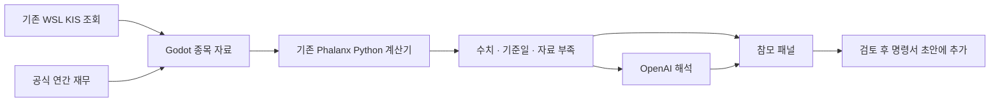

# Phalanx · AI 참모와 Python 연결

시장 화면의 **종목 분석 · 참모 →**에서도 선택한 보유·관심종목을 그대로 열 수 있습니다. 목록은 초기 5종목에 제한되지 않습니다. 이동 자체는 API를 호출하지 않으며 잔고 금액·수량을 참모 컨텍스트에 추가하지 않습니다.

2026-09-29 구현 기록

## 사용법

**사령부 → 작전 지도 → 리서치 → 종목 참모**에서 사용합니다.

1. **연결 설정**에서 OpenAI API 키를 붙여넣고 **암호화하여 저장**을 누릅니다. 키는 마스킹되며 다시 열어도 표시하지 않습니다. 빈 키로 저장하면 기존 키를 유지합니다.
2. 기본 모델은 `gpt-5.4-mini`입니다. 다른 Responses/Structured Outputs 지원 모델로 변경할 수 있습니다.
3. 설정창을 닫고 **핵심 브리핑**을 누릅니다. 저장은 키 보관까지 확인하며 실제 인증·모델 권한은 요청 시 확인합니다.

키를 만들기 전에는 **지표만 계산**을 사용하세요. Python 계산 결과라고 표시하며 AI 의견을 만들어 보여주지 않습니다. **실제 OpenAI 응답은 아직 검증하지 않았습니다.** OpenAI API 사용료는 API 계정에 별도로 발생할 수 있습니다.

| 요청 | 사용하는 자료 | 활용 |
| --- | --- | --- |
| 핵심 브리핑 | 선택 종목의 지표·재무자료·노트 | 사실의 의미와 다음 확인 사항 |
| 가설 반박 | 위 자료와 아래 리서치 노트의 투자 가설 | 가설의 약점·반증 조건·빠진 근거 |
| 작전 검토 | 위 자료와 모의 목표 배분·명령서 초안 | 집중도와 판단 근거·위험 검토 |

각 카드의 **근거**에서 기준일과 원자료를 펼칩니다. **해당 자료로 이동**은 차트·재무·노트로 이동하고, **원문 / 출처 열기**는 공식 출처를 엽니다. **명령서 근거에 추가 / 위험에 추가**는 기존 초안에 출처와 함께 덧붙여 저장한 뒤 명령서를 엽니다. 항목별 2,000자를 넘으면 추가하지 않습니다. 봉인한 과거 기록은 바꾸지 않습니다.

종목·자료·노트·계획이 바뀌면 이전 답변을 초기화합니다. 요청 취소도 가능합니다. 취소 이전에 전송된 요청에는 비용이 발생할 수 있습니다.

## 이번에 연결한 Python



기존 `phalanx.market_data.features.calculation.calculate_price_features`를 **직접 호출**합니다. 수익률·변동성·낙폭을 Godot이나 AI에 다시 구현하지 않았습니다. Decimal 계산, 필요 관측 수, 입력 해시와 누락 사유도 활용합니다. 삼성전자 연간 영업이익률과 전년 대비 변화는 연결 코드에서 계산합니다.

표시 지표는 20·60개 **관측 구간** 수익률, 20구간 연환산 변동성, 60구간 최대 낙폭입니다. N구간에는 N+1개 종가가 필요합니다. 거래일 누락은 미검증이며 배당 포함 수익률이 아닙니다. 변동성은 기존 엔진의 표본분산·연 252기간 환산 정책을 따릅니다. 차트의 표시 기간과 별도로 전체 조회 일봉에서 지표별 필요 기간을 사용합니다. 조회 자료를 계산 모델에 매핑한 임시 입력임을 명시하고, 기존 종목 선정/수집 작업 결과로 저장하지 않습니다.

AI에는 계산된 사실, 허용한 출처, 노트, 자료 부족 목록을 전달합니다. 모의 계획은 작전 검토에만 포함합니다. 잘못된 출처 ID·응답 형식·인증·한도·시간 초과를 처리합니다. 출처 ID 검사는 내용의 정확성을 보증하지 않으므로 AI 문장은 검토할 의견으로 표시합니다. 공시·뉴스 자동 검색은 아직 없습니다.

**리서치 일봉과 계좌의 조회 가격은 서로 다른 관측 자료입니다.** 작전 검토는 포트폴리오에서 명령서에 적용한 실계좌 기반 목표 비중을 사용합니다. 계획의 금액·수량·계좌번호는 제외하며 사용자가 작성한 명령서 문장과 노트는 전송 안내 범위에 포함합니다. ETF 내부 종목 분석과 실제 주문은 연결하지 않았습니다.

## 기존 코드의 다음 연결 순서

| 단계 | 기존 Python 기능 | 다음 화면 | 필요한 선행 자료 |
| --- | --- | --- | --- |
| 완료 | `market_data.features.calculation.calculate_price_features` | 종목 참모의 계산 근거 | 선택 종목의 일봉 |
| 다음 권장 | `portfolio.allocation_input.calculation.prepare_allocation_input`, `portfolio.allocation_targets.calculation.calculate_allocation_targets` | 현재 목표와 위험 기반 배분안을 비교하는 작전 검토 | 전체 대상 종목의 날짜가 정렬된 가격·선정 결과·동일 기준일 |
| 이후 | `portfolio.dynamic_risk_model.DynamicRiskModel` | 장기·빠른 반응·느린 반응·하락장 가정의 위험 비교 | 충분한 공통 관측·결측 정책·계산 버전 |
| 이후 | `nav.engine.calculate_daily_nav` | 작전 이후 성과·낙폭 복기 | 실제 또는 명시적인 모의 원장·입출금·거래·평가가격·벤치마크 |

수동 목표 비중에 따른 실계좌 변경안 계산과 명령서 적용은 [포트폴리오 시뮬레이터](PORTFOLIO_SIMULATOR.md)에 연결했습니다. 위험 기반 자동 배분은 공통 관측 이력 등이 필요한 후속 작업입니다.

Python의 수집·계산·저장 계층을 유지하고 Godot에는 화면에 필요한 결과만 전달하는 구조가 적합합니다. Windows/WSL 저장소는 확인 당시 같은 커밋 `82ff591`이었습니다. 이번에는 Python 원본을 수정하지 않고 Godot 프로젝트에 연결 코드를 추가했습니다.

## 실행 환경과 저장

- 프로젝트: `C:\Users\hanso\dev\phalanx-godot-prototype\phalanx-headquarters`
- 참모 실행기: `C:\Users\hanso\dev\phalanx\.venv\Scripts\python.exe`; 기존 `phalanx`, `httpx`, `win32crypt` 사용
- 일봉 조회: 기존 WSL Ubuntu-24.04 Phalanx 환경 유지
- 새 코드: `scripts/advisor_panel.gd`, `advisor_settings.gd`, `advisor_process.gd`; `tools/advisor_bridge.py`, `advisor_engine.py`, `advisor_openai.py`
- 키: `%LOCALAPPDATA%\Phalanx\advisor\openai.json`에 현재 Windows 사용자의 DPAPI로 암호화합니다. 다른 계정/기기로 복사하여 사용하는 방식은 아닙니다.
- 키는 명령줄 인자나 일반 요청 파일에 넣지 않고 익명 파이프로 전달합니다. 노트·자료의 임시 요청/결과 파일은 완료·취소·정상 종료 시 정리합니다. 강제 종료·전원 차단 시 잔여 파일 가능성은 있습니다.
- API는 고정된 OpenAI HTTPS 주소를 사용하고 `store:false`를 지정합니다. 이것이 모든 서비스 로그의 미보존을 의미하지는 않습니다.
- 현재 개발 PC용입니다. 배포에는 Python 런타임·모듈·도구 파일 패키징이 필요합니다.

환경 변경용: `PHALANX_ADVISOR_PYTHON`(실행기), `PHALANX_ADVISOR_CONFIG`(설정 파일), `PHALANX_ADVISOR_REQUESTS`(임시 폴더), `PHALANX_ADVISOR_OFFLINE=1`(AI 호출 차단). 저장된 키가 없을 때만 `OPENAI_API_KEY` 환경변수를 사용합니다. 일반 사용자는 앱의 연결 설정만 사용하면 됩니다.

## 검증

- Python 테스트 10개 통과: 기존 계산, 자료 부족/오류, 암호화 왕복, 요청/응답 형식, 출처 검증, 인증·한도·시간 초과. API는 모의 응답으로 검증했습니다.
- Godot 참모 통합 검사 55개 통과: 실제 Python 프로세스·익명 파이프, 종목 변경/취소, 임시 파일 정리, 초안 보존·저장, 네 해상도와 설정창 Esc.
- 기존 회귀 검사 통과: 종목 자료 55, 명령서 37, 명령서 UI 48, 저장 45, 워크스페이스 43개 검사.
- 실제 Godot 실행과 Windows 창 조작으로 리서치·계산·근거 펼침·설정창을 점검했습니다. KIS 일봉 조회와 Python 계산도 실제 연결했습니다.
- 후속 확인: 사용자 키 저장과 결제 설정 후 실제 OpenAI 브리핑 응답을 확인했습니다. 포트폴리오 검토도 합성 입력으로 `gpt-5.4-mini`의 실제 응답을 확인했습니다. 후속 참모 통합 검사 73개가 통과했습니다. 테스트용 설정은 격리된 임시 경로에서만 사용합니다.

프로젝트 폴더에서 실행:

```powershell
& C:\Users\hanso\dev\phalanx\.venv\Scripts\python.exe tests/test_advisor.py
& C:\Users\hanso\Tools\Godot\Godot_v4.7.2-stable_win64_console.exe --headless --path . --script res://tests/advisor_test.gd
```

구현 확인 문서: [OpenAI Structured Outputs](https://developers.openai.com/api/docs/guides/structured-outputs), [GPT-5.4 mini](https://developers.openai.com/api/docs/models/gpt-5.4-mini), [API 데이터 처리](https://developers.openai.com/api/docs/guides/your-data), [Godot 프로세스 API](https://docs.godotengine.org/en/stable/classes/class_os.html), [Windows DPAPI](https://learn.microsoft.com/en-us/windows/win32/api/dpapi/nf-dpapi-cryptprotectdata).
