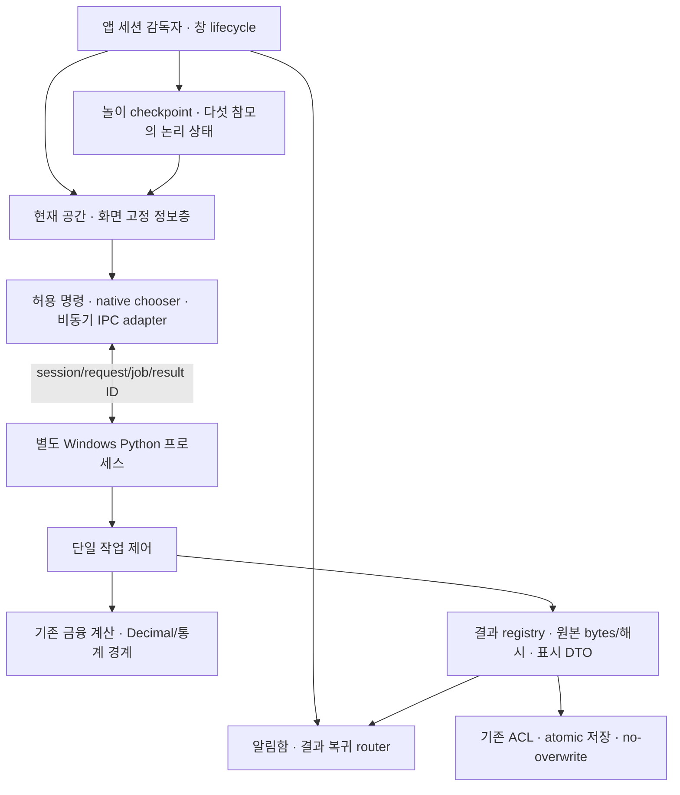

# 팔랑크스 함교 제작 사양
> **폐기된 SF 검토 이력 — 현재 구현 기준 아님 (2026-09-26).**
> SF·우주전함 방향은 폐기됐다. 현재 적용 문서는 [원정군 사령부 설계](../expedition-headquarters/spec.md)다.
> 아래 본문과 당시의 상태/권고는 기존 작업 보존을 위한 기록이다. 현재의 미술·엔진·지원 사양 지시로 사용하지 않는다.
> 재사용할 Python·작업 수명·저장 계약은 새 문서군에 통합했다.

상태: **조사·설계안, 제품 구현 전**. 조사일 2026-09-26. 기준은 PR #25가 병합된
`main@de77b6b41fde2a82753d70cf78eaef11a28449df`, 작업 브랜치는
`design/command-bridge-spec`이다. 이번 변경은 이 문서와 [기술 결정안](../decisions/command-bridge-rendering.md),
[자산 계획](assets.md)뿐이다. 아래 동작·예산·합격 기준은 다음 실험의 제안이며 구현·성능 측정 결과가 아니다.

## 1. 경험과 범위

사용자는 우주전함의 사령관이며 참모들과 시장을 분석하고 포트폴리오를 편성한다.
최종 방향은 **사용자가 승인했던 사실적인 함교의 미적 목표를 유지하는 고품질 3D**다.
게임을 플레이하는 감각, 아름다운 공간·인물, 폭넓은 PC 접근성을 함께 추구한다. 기본·고급
그래픽 설정을 검토하고 기본에서도 캐릭터와 상호작용의 매력을 유지한다. 캐주얼 전환이나
초고사양 PC 전용으로 확정하지 않는다. 정확한 금융 기능, 게임 감각, 성능, 미적 완성도는
각각 평가하며 **대표 함교와 실제 Python 분석의 동시 실행 검증 후 엔진과 지원 사양을 확정**한다.

첫 구현 단위는 **고정 카메라의 함교 한 곳**이며 장기 구조는 여러 공간·다섯 참모·짧은
미니게임을 수용한다. 방 이동은 우선 지도/출입 장치 선택과 짧은 전환으로 설계한다.
자유 보행·전투·완전한 AI 대화·실시간 계좌/주문 연결·새 비중 알고리즘은 첫 검증에서 제외한다.
다섯 참모의 외형/일상 상태와 미래 AI 분석 능력은 별개다. 연출용 대사를 실제 AI 분석 결과처럼
표현하지 않는다. 이름이 정해진 인간 참모는 헤파이스티온이며 나머지 네 명의 이름/역할은 미정이다.

### 참고 작품의 역할

아래는 사용자가 지정한 **참고 역할**이다. 작품의 자산·UI·캐릭터를 복제하는 계획이 아니다.

| 참고 | 팔랑크스에서 탐색할 방향 |
|---|---|
| StarCraft II / Mass Effect | 함내 공간의 용도, 참모의 생활과 방문할 이유 |
| Deus Ex / Hades | 역사 모티프의 현대적 변형, 실루엣·태도·말투로 구별되는 인물 |
| Endless Space 2 | 아름다움과 정보 위계가 공존하는 읽기 쉬운 데이터 화면 |
| Astroneer / Deep Rock Galactic | 멀리서도 읽히는 형태, 선택·접촉에 분명히 반응하는 사물 |
| Homeworld | 작은 호위함과 거대한 행성의 대비, 항해와 함대의 규모감 |
| Mini Metro / Observation | 짧게 이해하고 선택하며 결과를 확인하는 놀이 |

고유 함선·복식·문양·글꼴 구성·음향을 제작한다. 채팅의 승인 이미지가 로컬에 있다고 가정하지
않았다. 필요한 참조만 [자산 계획](assets.md#추가로-필요한-참조-자료)에 정리한다.
앞서 조사한 표현 방식별 미술/비용/부하와 네 엔진 후보는 [기술 결정안](../decisions/command-bridge-rendering.md)에 비교한다.

### 첫 플레이 순환

장치를 발견 → 주목/선택 반응을 읽음 → 분석을 의뢰 → 참모의 짧은 반응과 선택형 놀이 또는
다른 공간 방문 → 완료 알림 → 결과 확인/시나리오 비교 → 원본 저장 → 원래 활동으로 돌아간다.
분석 대기 시간은 플레이를 강제하는 타이머가 아니다. 미니게임을 건너뛰어도 모든 분석·저장에
접근하며, 놀이 점수/성공이 금융 결과·비중·계산 속도를 보상으로 바꾸지 않는다.

장치마다 클릭에 대한 모양/소리/인물 주목 중 적절한 반응을 주고, 선택 후 작은 상태 변화와
되돌아올 이유를 만든다. 단순히 버튼을 3D 물체 위에 붙인 것만으로 게임 감각을 통과시키지 않는다.

## 2. 화면·미술 설계

### 고정 구도

구도는 16:10과 16:9를 함께 검토한다. 현재 개발 PC는 16:10이며 추가 지원 대상 PC와
해상도는 실측 후 확정한다. 두 비율에서 중요 대상이 잘리지 않도록 안전영역을 유지한다. 아래 비율은 최초 구성 초안이며, 모델 도입 전 정지 화면 검토로 확정한다.

| 대상 | 화면 위치 초안 | 제작 의도 |
|---|---|---|
| 전면 창 | 왼쪽 8%–중앙 76%, 위 8%–42% | 함선의 항해 방향과 원근을 읽는 배경; 별·행성이 UI보다 밝지 않게 |
| 중앙 전술 테이블 | 가로 20%–65%, 세로 42%–83% | 전경의 중심 장치; 투사원·궤도·국소 빛이 서로 구분됨 |
| 헤파이스티온 | 오른쪽 70%–91%, 세로 29%–88% | 얼굴·손·상체 실루엣을 읽으며 사령관/테이블로 시선 전환 |
| 작업 단말·승무원 | 왼쪽과 중경 | 함교가 실제 운용 중인 장소임을 보여 줌; 주목도를 낮게 유지 |
| 정확한 데이터 패널 | 왼쪽–중앙의 별도 2D 정보층 | 필요할 때 넓어지고 얼굴·주요 조작을 가리지 않음 |

카메라는 고정하고 임의 흔들림·줌·자동 이동을 넣지 않는다. 수직 FOV 35–45도는 구도 시험
출발값이며 최종값은 인물과 전술 테이블의 비례로 정한다. UI를 열어도 카메라는 움직이지 않는다.

### 재질·조명·형태

- 어두운 도장 금속, 가공 금속의 모서리, 유리, 직물의 반응을 구별한다. 모든 표면을 같은
  회색·거칠기·노이즈로 채우지 않는다. 설득력 있는 치수·두께·재질과 정제된 실루엣을 갖춘다.
  이음새·손잡이·패널은 용도와 스케일이 읽혀야 한다. 인물의 피부·눈·머리·제복은 실제 카메라
  거리에서 자연스럽고 매력적으로 보여야 하며 모든 면을 미세 흠집으로 채우는 방식은 피한다.
- 청록은 장치의 활성/정보, 호박색은 인물의 온기·주의 상태에 사용한다. 실패는 색뿐 아니라
  문구·아이콘·상태로 구분한다. 작은 발광면과 보조 광원을 조합하고 과도한 bloom을 억제한다.
- 창의 큰 환경광, 테이블의 국소광, 헤파이스티온의 절제된 key/fill/rim을 분리한다.
  얼굴이 실루엣에 묻히거나 금속 반사가 수치를 가리지 않아야 한다. baked 조명/그림자와
  동적 보조광 조합을 기본 설정의 출발안으로 시험한다. 실시간 GI·ray tracing·strand hair 같은
  기법의 사용 여부는 결과 품질과 비용으로 정하며 특정 기법을 사실적 미술의 필수 조건으로 두지 않는다.
- 팔랑크스 고유 형태 언어는 넓은 판면, 반복되는 좁은 수직 리브, 절제된 Φ 계열 문양이다.
  자산마다 서로 다른 장식·문자·기술 수준을 섞지 않는다. 색·재질 swatch와 노출 기준을 공유한다.
- 성능 측정용 화면에도 승인된 재질·조명·머리카락·장치 효과를 유지한다. 미술 효과를 끈
  측정값으로 그 효과가 있는 화면의 성능을 통과시키지 않는다. 기본·고급은 같은 미술 목표와
  인물·상호작용을 공유하며 각 설정의 완성 화면과 성능을 별도로 검증한다.

### 기본·고급 그래픽 설정

아래는 검토할 구성안이다. 실제 지원 기법·수치는 임시 선택한 엔진과 기준 PC에서 고정한다.
기본 설정 자체를 완성된 미술·플레이 경험으로 승인하며, 고급 설정에서만 인물의 매력이
성립하는 설계는 통과시키지 않는다.

| 항목 | 기본 설정 | 고급 설정 | 두 설정의 공통 합격 기준 |
|---|---|---|---|
| 공간·조명 | baked/probe와 필요한 동적 조명·그림자로 깊이와 재질을 유지하는 안 | 간접광·반사·그림자·공간 효과의 세부 표현 강화 검토 | 어두운 금속, 청록·호박 조명, 전면 창과 테이블의 구도·분위기 유지 |
| 인물 | 적절한 LOD·머리 표현·재질 비용 조절; 얼굴·눈·손·제복의 자연스러움 유지 | 피부/머리/의복·그림자의 세부 품질 강화 검토 | 같은 고유 캐릭터, 표정·시선·주목·착석 접점·동작 타이밍과 반응 유지 |
| 장치·창밖 | 투사·궤도·상대 운동은 유지하고 입자·반사·원거리 세부량 조절 | 효과·원거리 재질·공간감의 세부량 강화 검토 | 선택 피드백, 행성 자전·함선 시차, 상호작용 의미와 응답성 동일 |
| 정보·놀이 | 안정적인 2D 데이터층과 동일한 놀이 기능 | 같은 정보층·놀이, 배경 세부 표현만 조절 | 한글·정확한 수치·알림·저장·중단/재개 기능 및 읽기 크기 유지 |

동일한 카메라·동작·입력의 정지 화면/영상과 실제 플레이로 두 설정을 나란히 평가한다.
기본에서 인물을 단순 인체로 바꾸거나 표정·주목·반응을 제거해 성능을 맞추지 않는다.
그래픽 설정 전환은 Python 작업/결과·놀이 checkpoint를 보존해야 하며, 설정 전환의 메모리
최고점·프레임 지연도 측정한다. 자동으로 알리지 않고 설정을 바꿔 성능을 통과시키지 않는다.

### 읽기와 조작

금융 수치는 투시된 3D 글자나 홀로그램의 광번짐 속에만 놓지 않는다. 엔진을 선택해도
정확한 값은 엔진의 화면 고정 2D 정보층에서 보여 주며, 공간 장치는 요약·선택·상태를 표현한다.

- 한글 지원 폰트를 제품에 명시적으로 포함하는 계획을 세운다. 본문은 16–18 DIP 상당,
  긴 종목명은 2줄 이상 확장·상세 보기·복사를 지원한다. 실제 폰트 raster와 DPI에서 재검증한다.
- 열 머리글에 단위를 표시하고, 소수점·음수·자릿수·정렬을 일관되게 처리한다. 원본 exact 값은
  Python이 제공하는 문자열을 그대로 표시·복사한다. 반올림 요약에는 명시적인 표기와 원본 접근을 둔다.
- 예시 문자열 `팔랑크스 글로벌 반도체·친환경 인프라 장기성장 테스트기업`, 0, 음수,
  `0.12345678901234567890`, 실패 진단을 함께 확인한다. 허용되지 않는 금융 입력은
  계산 fixture를 변조하지 않고 별도의 표시 전용 합성 사례로 시험한다.
- 본문 대비 4.5:1, 큰 글자/주요 조작 3:1을 설계 목표로 삼고 실제 합성 화면에서 측정한다.
  Tab 순서·명확한 초점·Enter/Space·시나리오 화살표·스크롤·클립보드를 검증한다.
- 데이터 집중 모드에서는 배경 움직임·광량·음향을 낮춘다. 장식이 입력 잠금·실패·저장 상태를
  덮지 않는다. `input_unavailable`, `common_failure`, `partial`, `failed`를 성공 연출과 구별한다.

## 3. 서로 다른 움직임과 장치 반응

아래 시간은 연출 초안이지 관측값이 아니다. 모든 동작을 하나의 사인파나 공통 타이머에 연결하지 않는다.

| 계층 | 첫 장면 목표 | 독립 제어와 검증 |
|---|---|---|
| 호위함 2–3척 | 서로 다른 거리·측면 이동·작은 방향 보정 | 상대 위치/속도 곡선과 시작 위상을 분리; 60초 영상에서 복제된 일괄 왕복이 없어야 함 |
| 행성 | 구면 표면의 자전과 항해 시차 | UV가 붙은 구체를 자전시키고 항해에 따른 상대 위치를 별도로 변경; 광원/명암 경계와 표면 이동을 분리 |
| 우주 배경 | 항해 기준점 | 먼 별은 거의 병진하지 않고 가까운 호위함과 행성의 시차가 다름; 창 프레임은 함교에 고정 |
| 승무원 | 각자 자세 변경·기립·착석·짧은 보행 | 첫 방 확장 때 2–3명 계획. 장기의 다섯 참모와 별도이며 전원을 상시 렌더하지 않음. posture 9–23초, 이동 45–110초 범위의 개별 상태 머신·위상; 동선/좌석 예약으로 겹침 방지 |
| 헤파이스티온 | 호흡·시선·주목·자세 전환 | 몸 전체를 계속 흔들지 않고 시선/목/상체를 단계적으로 연결; 사령관→테이블→대기 시선의 이유가 읽혀야 함 |
| 전술 테이블 | 투사원·빛·궤도 | 클릭은 투사 시작, 실행 중에는 제한된 궤도 움직임, 결과는 선택된 시나리오로 정착; 가짜 백분율 없음 |
| 단말 | 점등·스캔·상태 램프 | 스캔과 점등을 분리하고 테이블과 같은 박자로 깜박이지 않음; 읽는 동안 스캔이 글자를 통과하지 않음 |

애니메이션 전이는 발·손·좌석 접점, 발 미끄러짐, 의복 관통, 머리/목 회전 한계를 검사한다.
리타기팅으로 얻은 클립도 실제 의자 높이와 동선에 맞춰 수정한다. 테스트용 random seed를
기록해 문제를 재생할 수 있게 하되 실제 동작은 인물별로 위상을 다르게 둔다.

계산 시작·완료와 애니메이션 완료는 다른 이벤트다. 장치/인물이 늦게 반응해도 계산 상태와
저장 가능 여부를 속이지 않는다. 최소화하면 공간 연출·음향을 정지하고 UI/통신의 필요한
처리만 유지한다. 복원 시 누적 동작을 한꺼번에 재생하지 않으며 음향은 자동 재개하지 않는다.

## 4. 음향 사양

최초 실행은 무음이다. 사용자가 켠 뒤 함교 환경음, 단말/테이블 피드백, 인물/좌석 소리를
각 버스로 제어한다. 첫 실험에는 짧은 공간 loop와 장치 cue, 필요한 인물 접촉음만 포함한다.
완성형 음악·대사·립싱크·AI 음성은 포함하지 않는다.

동시에 여러 성공음이 중첩되지 않게 voice 수와 우선순위를 정한다. 실패·저장 완료의 소리는
본문 상태와 일치해야 한다. 반복 이음새·클릭·클리핑·좌우 공간감·음량 피로를 헤드폰과
노트북 스피커로 직접 청취한다. 자동 mute/state 테스트는 청취의 대체 증거가 아니다.

## 5. 기존 Python과 새 화면의 경계

[기술 결정안](../decisions/command-bridge-rendering.md#기존-코드의-재사용과-변경-경계)에
재사용/변경 범위와 실제 코드 링크를 정리했다. **제품 엔진은 미확정**이다. 후속 실험 시작 시
제작 여건·라이선스·기준 PC를 확인해 후보 하나를 임시 선택하고, 대표 함교와 실제 Python 분석의
동시 실행 결과로 제품 채택 여부를 결정한다. 이하 작업/결과 계약은 엔진에 종속되지 않는다.
여러 후보의 시제품을 동시에 구현하지 않는다.

현재 `DesktopApplication._complete()`는 HTML 생성에 결합돼 있고 `_start()`는 `_payload`와
현재 상태를 교체한다. `job_status/save_result`도 현재 작업만 받는다. 따라서 **현재 구현이
방 이동·과거 결과 복귀를 이미 지원한다고 볼 수 없다**. 다음 구현에서 HTML과 무관한 표시
snapshot, Python 소유 결과 registry, 앱 수명의 session supervisor를 추가할 계획이다.
`active_job_id`와 `selected_result_id`를 분리하고 화면에는 복사/직렬화한 DTO를 보내 mutable 모델을 공유하지 않는다.
기존 HTML renderer는 별도 소비자로 남긴다. 금융 수식·Decimal 처리·원본 저장을 게임에 복제하지 않는다.

### 공간·작업·결과·놀이의 수명

| 소유자/수명 | 보존할 상태 | 해제/교체 규칙 |
|---|---|---|
| 앱 세션 감독자 / 프로세스 세션 | Python 연결, job 구독, 알림함, 결과 선택, 이동 경로 | 공간 unload가 종료 요청을 보내면 안 됨. 앱 닫기만 새 명령을 막고 backend 종료 절차 수행 |
| Python 작업 제어 / 작업 | `session_id/job_id/generation`, 실행·조회·저장 상태 | 단일 계산 유지. 방·놀이·인물 전환으로 generation 증가/취소/재시작 금지 |
| Python 결과 registry / 앱 세션 | 불변 `result_id`, 원본 bytes·SHA, 입력 provenance, DTO, 저장 상태 | 새 계산 B가 완료 A를 지우지 않음. 저장은 선택한 result ID에 대해 기존 저장 서비스 호출 |
| 공간 presentation / 공간 instance | 카메라, 선택 장치, 장면 자산 handle, 구독 | `room_epoch`로 파괴된 장면 callback만 차단. 앱의 job 수신까지 버리지 않음; 복귀 시 최신 snapshot 구독 |
| 참모 상태 / 앱 세션 | 다섯 안정 ID, 위치/생활 상태/마지막 반응 이벤트 | 화면 밖에서는 간단한 논리 상태만 유지. rig·음성·텍스처는 필요한 공간에서만 로드 |
| 놀이 세션 / 앱 세션 | `minigame_id/instance_id`, schema version/checkpoint revision, RNG 상태, 선택·점수·남은 시간, 논리 tick, 복귀 위치 | scene 객체/texture 포인터 없이 직렬화 가능한 checkpoint. 안전한 tick에서 checkpoint를 세션 메모리에 확정한 ACK 후 unload; 디스크 저장을 뜻하지 않음 |

결과 registry는 무제한 메모리 캐시가 아니다. 첫 실험은 완료 결과 2개 이상을 보관하고,
정확한 개수/bytes 상한은 기준 PC 예산으로 확정한다. 미저장 결과·현재 표시 결과·알림이 참조한
결과는 자동 삭제하지 않는다. 원본 JSON 한도뿐 아니라 DTO·파싱 객체·선정 bytes·알림/저장 참조도 메모리에 산입한다. 상한에 닿으면 기존 결과를 유지하며 새 작업을 거절하고 저장 후
명시적 정리를 안내한다. 작업 접수 전 결과 슬롯/최대 bytes 여유를 예약하며 원본이 없는 운영 실패 시
예약을 반환한다. `partial`/`failed` 금융 상태여도 결과 bytes가 생성됐다면 슬롯과 원본을 보존한다. 저장을 했다는 이유로 알림 대상이 사라지지 않는다. 이 변경은 **새 작업 제어 기능**이며
기존 한 개 `_payload`를 UI에 복사하는 것만으로 대체하지 않는다.

B 계산 중 A 저장 요청은 **A의 result ID/승인된 목적지를 고정한 한 건의 저장 대기**로
받고, B가 성공 또는 실패로 끝난 후 기존 저장 서비스로 직렬 실행한다. backend 자체가 죽으면
대기를 성공으로 간주하지 않고 연결 장애로 표시한다. 대기/저장/실패를 구분하며 대기 중에는
취소할 수 있다. 활성 파일 쓰기는 강제 취소하지 않는다. 추가 저장 요청은 식별 가능한 busy
응답으로 거절한다. 대기·저장 중 A 삭제나 새 계산은 거절하되 B 조회·놀이·공간 이동은 유지한다.
저장 시 목적지 guard/ACL/no-overwrite를 다시 검증하며 실패해도 A를 보존한다.

Python이 결과를 확정한 뒤 terminal 이벤트를 발행하고 앱은 `(session_id, job_id, terminal revision)`으로
중복 제거한다. 결과 없는 작업 예외도 terminal job 요약에 남긴다. 구독 재연결/조회 실패 후에는
작업 요약과 결과 목록을 재조회해 놓친 완료/실패 알림을 복원한다. 전송 exactly-once를 가정하지 않는다. 정보창을 강제로
열거나 놀이의 입력을 빼앗지 않고 지속 알림함에 결과 링크를 만든다. 실패/부분 결과는 그 상태를
표시한다. 사용자가 알림을 선택하면 현재 놀이 checkpoint를 확정 → 필요한 자산 로드 → 해당
`result_id`의 결과 패널로 이동한다. 결과 없는 실패 알림은 해당 job의 진단으로 이동한다.
표시가 실제 완료된 후 읽음으로 바꾸며 알림함 항목은 화면 방문만으로 삭제하지 않는다. 뒤로/놀이 계속은
원래 공간·놀이·초점으로 복귀한다. 원래 공간이 unload됐어도 checkpoint에서 재구성한다.

이동 중 완료·알림 연속 클릭·복귀 도중 두 번째 작업 완료는 router가 하나씩 처리한다.
같은 목적지 요청은 합치고 오래된 이동 callback은 `room_epoch`로 버린다.
중단 순서는 신규 입력 차단/눌림 해제 → 현재 tick 완료 → 일관된 checkpoint 확정/ACK → unload다.
재개는 schema/instance/revision 검증 → 장면 준비 → 상태 복원 → 사용자 재개이며 tick 중간 snapshot은 금지한다. checkpoint나
새 공간 로드 실패 시 현재 상태를 유지하고 재시도를 제공한다. 결과는 Python에 계속 남는다.
놀이 상태는 `running → pausing → suspended → resuming → running`으로 구분하고 전이 중 입력을
중복 수락하지 않는다. 정지 시 눌린 키/마우스를 해제하고 이전 timer/audio callback을 폐기한다.
명시적으로 결과를 삭제할 때 관련 알림도 정리하고, 늦은 알림/이전 세션 ID는 최신 결과로 대체하지 않는다. 정지 중 timer/점수/선택을 진행하지 않고 경과 시간을 몰아서 적용하지 않는다.

최소화는 놀이 checkpoint/시각·음향 정지이며 Python 분석은 계속된다. 복원 후 결과 알림은
보이되 놀이·음향은 사용자 동작으로 재개한다. **이 보존 약속은 실행 중 앱 세션 내**다.
앱/OS crash 뒤 미저장 결과·놀이의 영속 복구는 이번 실험에서 보장하지 않는다. 정상 종료는 두 단계다.
`close_intent`에서 새 계산/놀이/이동은 막되 진행 작업의 완료·조회와 미저장 결과의 선택 저장은
허용한다. 사용자는 저장/명시적 버리기/종료 취소를 결정할 수 있다. 대기 중 새로 완료한 결과도
안내하며, 종료 취소 전에는 되돌릴 수 없는 기존 `request_close`를 호출하지 않는다.
이 절차와 승인된 저장이 끝나야 `close_requested`로 모든 새 명령을 차단하고 기존 worker/
파일 정리·backend ACK/exit·창 종료를 수행한다. 개인정보가 든 결과를 자동 디스크 checkpoint에
넣지 않는다. 장기 영속 저장은 별도 스키마·보존 정책으로 설계한다.

### 다음 실험의 통신 계약 초안

| 항목 | 결정 |
|---|---|
| 프로세스 | 엔진이 고정된 앱 패키지의 Windows Python backend 하나만 시작. Editor Python 또는 WSL 프로세스를 런타임으로 사용하지 않음 |
| transport | 부모가 소유한 익명 stdin/stdout pipe, 별도 stderr. 필요한 pipe end만 상속하고 사용하지 않는 end는 즉시 닫아 EOF를 보장. 외부 listener 없음. IO reader는 game/UI thread와 분리 |
| framing | 4-byte little-endian 길이 + UTF-8 JSON. control 최대 64 KiB, 표시 응답 최대 4 MiB를 실험 한도로 협상; 초과는 명시적 오류, 무한 할당/잘라내기 금지 |
| 식별 | `protocol_version`, 시작마다 새 `session_id`, 개별 `request_id`, `generation`, Python의 `job_id/result_id`, snapshot 순서 `revision`. 장면의 `room_epoch`는 별도이며 작업 식별자로 사용하지 않음 |
| 허용 동작 | hello, 파일 선택 승인 등록, open_result, calculate, job_status, terminal 작업 요약/결과 목록/표시/선택 결과 저장, 설정, close_intent/close_cancel/close_requested. shell/eval/범용 파일 읽기는 없음 |
| 데이터 | exact 금융 값은 문자열. UI용 시각 좌표는 표시 데이터와 분리. 원본 JSON bytes·결과 SHA-256·입력 selection SHA는 Python 소유 |
| 파일 | 엔진의 실제 native chooser만 승인 경로를 Python 어댑터에 등록하고 opaque token을 받음. Python이 종류·절대 로컬 경로·ACL/guard를 다시 검사 |
| 재조회 | timeout은 실패한 계산이나 취소를 뜻하지 않음. 같은 session/job/generation으로 재조회, 중복 요청은 식별 가능한 거절, 자동 재계산 없음 |
| 시작/장애 | hello 준비 10초를 넘으면 진단 표시. protocol 불일치·EOF·child crash를 명시적으로 표시하고 새 작업 차단. 로그에 원본 금융 payload를 남기지 않음 |
| 종료 | close_intent에서 계산 완료와 선택 저장/버리기·취소 처리 → 최종 close_requested에서 모든 새 요청 차단 → 파일·worker 정리 → Python 종료 ACK/exit 확인 → 엔진 종료. 강제 worker 종료를 정상 흐름으로 사용하지 않음 |

기존 입력/결과 JSON 검증 한도는 각각 32 MiB다. 위 4 MiB는 **실험 DTO 한도**이며 기존 파일
계약을 축소하는 변경이 아니다. 결과 원본을 pipe로 재구성하지 않고, 큰 표시 모델은 다음
설계에서 페이지화/상한 처리를 결정한다. 금융 경로는 기존 여섯 종목 합성 fixture 한 종류로 제한하되 보존 검사는 같은 입력을 A/B 작업으로 순차 실행한다.
파이프를 사용하는 backend는 stdout이 필요한 console-subsystem 빌드로 만들고 부모가 창을
숨겨 시작하는 방식을 검증한다. 무조건 `--windowed`로 포장하면 표준 입출력이 없어질 수 있다.

정상 닫기 대기 30초 초과는 안내·진단 상태이며 자동 강제 종료 기준이 아니다. UI가 비정상
종료되어 EOF가 나면 backend는 새 요청을 막고 진행 작업을 마친 뒤 종료한다. 저장되지 않은
메모리 결과의 crash 복구를 보장하지 않는다. 새 프로세스는 이전 결과를 자동 재계산하지 않는다.

## 6. 다음 단일 기술 실험: 함교 한 조각

목적은 **사실적 함교의 미적 품질·작은 플레이 순환·Python 독립 수명·동시 실행 비용**을 함께 확인하는
것이다. [결정안](../decisions/command-bridge-rendering.md)의 조건을 충족한 후보 하나만 실행한다.

| 포함 | 제한 |
|---|---|
| 대표 함교 부분 | 바닥·창 프레임·벽·좌석 한 구도. 사실적 미적 목표에 맞는 모델·재질·조명을 기본/고급으로 평가 |
| 장치 하나 | 전술 테이블 하나의 선택·투사·국소광·궤도 반응 |
| 인물 한 명 | 헤파이스티온 고유 실루엣·얼굴·제복의 rig, 대기/주목/착석/기립/2–3걸음. 기본에서도 자연스러운 피부·눈·머리·제복과 주목 반응 유지 |
| 창밖 일부 | 자전하는 구형 행성 일부와 호위함 한 척. 전체 호위함/승무원/다섯 참모 합격으로 확대 해석하지 않음 |
| 짧은 놀이 하나 | 테이블 위 3개 신호 노드의 연결 순서를 선택하는 30–90초 비금융 퍼즐. 규칙·성공/재시도·정지/계속만 구현 계획. 금융 보상 없음 |
| 이동 fixture | 자산을 거의 갖지 않은 별도 테스트 공간으로 왕복하여 실제 scene unload/load와 복귀 검사. 두 번째 완성 공간 제작 아님 |
| 데이터 한 경로 | 공개 합성 selection/history 한 종류 → 기존 Python 계산 → 네 시나리오 DTO → 원본 저장/재열기. A/B 두 작업 보존도 같은 입력 사용 |
| 정보 패널 | 긴 한글/정확한 수치·알림·저장·재조회·놀이 계속의 최소 UI. 새 금융 기능 없음 |
| 배포 | Windows 독립 패키지 + native Python backend. 에디터·개발 venv 없이 실행 |

순서는 구도/미술 방향·권리 확인 → 대표 정지 화면 → rig/장치/놀이의 작은 순환 →
앱 세션/결과 registry/IPC → Windows 패키지/동시 부하 측정이다. 임시 도형은 기술 확인에만
사용한다. 엔진은 실험용으로 임시 선택하며 제품 채택 확정과 구분한다. 다른 후보 시제품을 병행하지 않는다. 원인이 미술 자산이면
자산을 먼저 개선하고, 엔진 제약이 재현될 때 선택안을 다시 연다.

첫 연결 실험의 인물 1명·호위함 1척·여섯 종목 fixture만으로 제품 엔진이나 지원 사양을
확정하지 않는다. 이어 같은 후보에서 **대표 함교 부하 검증**을 수행한다. 첫 방의 승인 구도,
헤파이스티온과 계획된 승무원 2–3명, 호위함 2–3척·행성, 테이블/단말 반응, 결과 정보층을
실제로 함께 동작시키고 기본·고급 자산 목록/설정을 고정한다. 여러 완성 공간·다섯 참모 전체를
만드는 단계는 아니다. 이 검증 단계도 이번에는 설계만 하며 제품 구현을 시작하지 않는다.

### A. 기능 연결 합격

- 같은 Windows Python·의존성·입력에서 직접 서비스와 backend의 원본 결과 bytes/SHA-256이
  일치한다. 네 시나리오 순서·상태·exact 문자열도 일치하며 저장/재열기 bytes가 동일하다.
- selection/history 입력 해시가 전후 동일하다. 기존 파일 저장 충돌 후 결과가 남고 다른
  파일명으로 저장된다. native guard·ACL·atomic rename·실패 정리의 기존 테스트를 유지한다.
- 이중 클릭·응답 유실·조회 실패·이전 session/generation/revision 응답·backend crash를
  검사한다. 한 계산만 실행되고 오래된 결과를 화면에 적용하지 않는다. 결과 없는 실패 알림도
  재조회로 복구하며 동일 terminal 알림이 중복 표시되지 않는다.
- 실제 파일 대화상자와 긴 한글/공백 경로로 실행한다. 원본 JSON을 엔진에서 재직렬화하지 않는다.
- 계산 중/저장 중 닫기, idle 닫기, 최소화 30초 후 복원, 새 프로세스 재열기를 실제 Windows에서
  확인한다. 창·child·작업 thread가 남지 않는다. 최소화해도 계산은 완료하고 음향은 복원 후 무음이다.
- 탐색/파일 권한 검사는 기존 WebView 경로에 회귀를 만들지 않는다. 네이티브 UI의 상태 반영과
  저장은 연출 완료를 기다리지 않는다.

- 분석 시작 → 놀이 두 번 선택 → 테스트 공간 왕복 → 최소화/복원 → 완료 알림 → A 결과 표시/저장
  → 놀이 계속을 실행한다. 중복 작업 0, 원본 SHA 동일, 선택/점수/RNG/tick 유실·중복 0이어야 한다.
- A 미저장 상태에서 B 실행 후 A 알림을 눌러 A 표시/저장, B 알림으로 B 복귀를 확인한다.
  B 실행 중 A 저장은 대기 후 A bytes를 저장한다. 결과 상한·작업 접수 거절·저장 충돌 뒤에도 A/B가 남아야 한다.
- 종료 대기 중 결과 완료 → 저장 → 최종 종료와 종료 취소를 각각 검사한다. 취소 뒤 backend가
  closing에 남지 않으며 새 계산·놀이가 정상 가능해야 한다.
- 이동/정지/재개 각각의 경계에 완료/실패/중복 알림을 주입한다. UI 파괴 후 callback, 오래된
  revision, 알림 연속 선택에서도 결과를 잘못 연결하거나 놀이 선택을 두 번 적용하지 않는다.
  작업 지연은 어댑터 시험용 barrier와 합성 입력으로 만들며 금융 수식을 변경하지 않는다.

### B. 성능·안정성 합격 제안

**제품 엔진·최소/권장 사양·설정별 지원 범위는 실제 동시 실행 검증 전까지 미확정이다.**
관측한 Ryzen AI 7 350 / RAM 32 GiB / RTX 5070 Ti Laptop / 2560×1600·60 Hz·150%는
개발 비교 장비다. 이 장비 통과로 보급형 접근성을 주장하지 않는다. 같은 노트북의 내장 GPU
실험도 CPU/RAM/전력 차이가 있는 실제 보급형 PC의 대체 증거가 아니다.

먼저 확인된 개발 PC에서 대표 함교와 실제 분석을 함께 실행해 비용을 측정한다. 이어 접근
가능한 추가 Windows PC에서 기본·고급의 지원 범위를 검증한다. 보급형 PC 확보를 첫 개발
측정의 선행조건으로 강제하지 않으며, 개발 장비만 통과했다고 초고사양 전용으로 확정하지 않는다.

각 실물 PC의 CPU/코어·RAM·GPU/전용/공유 메모리·WDDM budget·driver·화면/client/render 픽셀·
DPI·전원 모드·열 상태를 조회한 뒤 해상도·설정별 목표 fps·RAM/VRAM 상한을 측정 전에 고정한다.
추가 장비가 없으면 그 범위는 **미검증**으로 남기고 전체 지원 사양을 확정하지 않는다.
에디터 사양을 제품 사양으로 옮기거나 사양표만으로 다른 PC 성능을 추정하지 않는다.

아래는 기준 PC 확인 뒤 채울 판정표다. **미확인 장비에 fps·해상도·메모리 수치를 먼저 지정하지 않는다.**
목표 fps를 F, 허용 계산 지연 배수를 R로 정하면 frame budget은 `1000/F ms`로 환산한다.

| 항목 | 기준 확인 뒤 확정할 값과 측정법 |
|---|---|
| 화면/품질 | 실제 client/render 해상도·DPI와 안정 모드 F를 확정. 30/60 fps는 비교할 모드의 예이며 현재 합격 목표가 아님. 개발 장비 2560×1600은 별도 참고. render scale·AA·vsync 명시 |
| 그래픽 설정 | 같은 사실적 미술 목표의 기본·고급을 각각 고정. 기본은 조명·LOD/mip·머리/효과 비용을 관리하며 매력 유지. 고급은 추가 세부 표현의 비용까지 포함해 별도 미술/성능 판정 |
| 시간 | 60초 warm-up 후 5분 × 3회: CPU main/render, GPU work, present P50/P95/P99와 최악 프레임. CPU/GPU work P95를 F의 frame budget과 비교. present P99 상한·긴 hitch 기준/허용 개수는 F와 함께 사전 기록 |
| 입력 | 장치/놀이/알림 입력부터 화면 반응 P95·최악 지연의 상한을 확정. 계산 완료까지의 시간과 구분하며 로딩 중에도 취소/상태 UI 반응 유지 |
| 메모리 | 엔진·backend·자식 프로세스 합산 Private Bytes와 working set, 시스템 가용 RAM/commit/page fault; GPU local/shared usage와 선택 adapter budget을 각각 기록. OS 여유를 뺀 실제 상한을 PC별로 정하며 shared RAM을 VRAM과 중복 합산하지 않음 |
| 시작/복원 | 실물 PC에서 cold/warm 시작·복원 입력 시간의 목표를 각각 확정. 최소화 중 지속 3D present·음향 없음, 분석 완료/알림 보존 |
| 유지 | 30분, 공간 왕복/놀이 중단·재개/결과 전환 20회에서 crash/OOM/device loss 0. 일정한 보존 결과 수로 warm 안정 구간 대비 CPU/GPU 메모리 증가가 5% 또는 128 MiB 중 큰 값을 넘으면 누수 조사 |

프레임 생성으로 실제 응답 지연을 숨기지 않는다. 기본 측정은 frame generation/upscaling off,
render scale 100%로 시작하고, 기본·고급 및 변경한 해상도는 별도 이름·스크린샷·측정으로 제시한다.
3D만 축소해도 데이터 UI는 원래 픽셀 밀도와 읽기 크기를 유지한다. 텍스처/mesh 업로드,
shader 첫 사용 hitch, 장면 전환 최고 메모리와 steady-state를 모두 남긴다.

#### 분석과 게임의 자원 경쟁

| 모드 | 비교 목적 |
|---|---|
| 게임만: idle / 인물·장치 / 놀이 | 승인 자산의 CPU·GPU·메모리 기본 비용 |
| 분석만: 게임 프로세스 없이 동일 packaged backend와 최소 IPC harness 실행 | 동일 합성 입력의 `T_analysis`, thread 수·CPU·RAM·I/O 기준. harness 비용도 기록 |
| 게임 상주/렌더 정지+분석 | 남아 있는 자산 메모리·게임 논리 비용의 별도 진단. 분석 단독 기준으로 사용하지 않음 |
| 분석+놀이 / 분석+공간 로딩 | 경쟁 시 frame/input 지연, 계산 시간 `T_concurrent`, DB read·asset decode/upload·peak RAM 충돌 |
| 분석+완료 알림/결과 UI / 원본 저장 | DTO 파싱·폰트 glyph/패널 생성·파일 flush와 main thread hitch |
| 최소화 중 분석 → 복원 | 렌더 정지에 따른 작업 진행, 알림 유지, 복원 시 일괄 업데이트 폭주 |
| 기본/고급 각각의 분석 동시 실행·설정 전환·worker thread 제한 | 두 설정의 품질·실제 비용·결과 정확성을 각각 판정. 기본 통과를 고급 통과로 기록하지 않음 |

동일 입력·dependency·전원/열 조건으로 각 모드를 반복한다. **실제 분석**은 공개 합성 입력으로
기존 `AllocationInputService/AllocationTargetsService`와 history 조회·원본 저장 경로를 실제
실행하는 것을 뜻한다. 사용자 개인 자료나 새 금융 기능은 필요하지 않다. mock 완료·캐시 결과
재생·artificial sleep은 동시 분석 성능의 증거로 쓰지 않는다.

여섯 종목 fixture는 첫 연결/정확성 검사의 고정 입력이다. 대표 함교 부하 검증 전에는 실제
지원할 분석 규모를 명시하고 그 규모의 유효한 공개 합성 입력·DB·해시와 실행 횟수를 고정한다.
입력이 너무 작아 렌더와 계산의 경쟁을 관측할 수 없으면 지원 사양 확정을 보류한다. 더 긴
분석이나 반복은 기존 단일 작업 정책/계산 로직을 유지하며 결과 수와 메모리 상한도 기록한다.
어댑터 barrier는 경계 정확성 검사에만 쓴다. 측정된 입력/장면 범위 밖의 성능을 보장하지 않는다.

계산 thread 하나가 numpy/scipy/BLAS의 내부 thread 하나라는 뜻은 아니다. native thread 수,
CPU 사용/경쟁, page fault, disk I/O와 renderer/GPU trace를 함께 기록한다. 대책 후보는
backend 시작 시 BLAS thread budget 고정, 중복 분석 차단, 자산 비동기 로드/업로드 분할,
오프스크린 인물 업데이트 축소, 기본·고급별 그림자/효과 예산 조정이다. scene 변경으로 분석을 중지하거나
결과를 삭제하는 것은 최적화가 아니다. thread 설정을 바꾸면 해당 설정의 직접 Python 실행과
backend bytes를 다시 비교한다. 기존 float 경계가 있으므로 설정 간 bitwise 동일성을 가정하지 않는다. Decimal 정밀도·
금융 수식·solver 반복 조건을 바꿔 frame 목표를 맞추지 않는다. 별도 프로세스가 CPU/RAM/열 경쟁을 없애지는 않는다.

동시 실행에서도 채택한 frame/input/메모리 상한과 원본 저장 일치를 모두 만족해야 한다.
계산 시간 비율 `T_concurrent / T_analysis ≤R`의 R을 기준 PC와 고정 입력의 단독 기준을
확인한 뒤 동시 실행 판정 전에 확정한다. 통과하지 못하면 병목과 시간 비율을 공개하고 프로필/동시성
정책을 다시 설계한다. 계산·미술 어느 한쪽을 끈 결과로 동시 실행을 통과시키지 않는다.
측정에는 선택 엔진 profiler와 Windows process 계측,
[DXGI budget/usage](https://learn.microsoft.com/en-us/windows/win32/api/dxgi1_4/ns-dxgi1_4-dxgi_query_video_memory_info)를 사용한다.

### C. 미술·연출 합격

기능/성능과 별도 판정표를 만든다. 승인된 크롭·노출·출력 해상도를 고정한 정지 화면 3장과
60초 실시간 영상, 실제 청취 기록을 제출한다. 최종권자는 사용자이며 렌더 담당 외 검토자도 참여한다.

구도/조명/재질/인물/움직임/한글 UI/음향을 각각 1–5점으로 평가한다. 승인했던 사실적 함교의
미적 목표에 대한 일치, 인물의 자연스러움·개성·매력과 상호작용의 설득력을 기본·고급 각각에서
평가한다. 고가 효과의 수만으로 점수를 주지 않는다. 기본의 미술 실패를 고급 점수로 덮지 않는다.
1은 임시·혼합된 표현, 3은 일관되지만 중요한 결함이 보이는 상태, 4는 기능과 미술이 안정적으로
읽히는 상태, 5는 세부 연출까지 정제된 상태다. **모든 항목 4 이상**을 목표로 하며 평균으로
낮은 항목을 덮지 않는다. 임시 도형·기본 인체·기성 mannequin만 있으면 미술 판정은 보류한다.

반사로 글자 소실, 한글 누락/잘림, 눈·목의 부자연스러운 주목, 발 미끄러짐, 좌석/손 관통,
동작 순간이동, 영상 전체의 동기화된 점멸, 평면처럼 미끄러지는 행성, clipping/loop seam은
차단 결함이다. 실제 청취 전에는 음향 항목을 통과시키지 않는다.

### D. 게임 감각 합격

기능 성공과 별도로 처음 보는 검토자가 설명 없이 장치의 선택 가능성을 알아보고, 선택 →
반응 → 작은 목표/결과 → 다음 선택을 이해하는지 관찰한다. 첫 과제는 테이블 선택, 분석 의뢰,
짧은 놀이 또는 건너뛰기, 알림으로 결과 확인, 놀이 계속이다. 초회 검토자 3명을 제안하며
혼란·오조작·무반응 구간과 실제 완료 시간을 기록한다. 한 명이라도 분석/놀이 상태를 혼동해
결과를 잃었다고 느끼거나 복귀 방법을 못 찾으면 원인을 수정하고 재검토한다.

선택의 이유·피드백·캐릭터 개성·다시 만질 의향을 각각 1–5점으로 평가하고 모두 4 이상을
초기 목표로 삼는다. 표본 3명으로 일반적인 재미를 입증했다고 주장하지 않는다. 미니게임이
분석을 강제로 기다리게 하거나 금융 성과의 허위 보상을 암시하면 통과시키지 않는다.

### 결과에 따른 다음 결정

기능 / 성능·안정성 / 미술·음향 / 게임 감각을 각각 `통과/실패/미검증`으로 기록한다.
첫 연결 실험 통과 뒤 대표 함교·실제 Python 분석의 동시 부하 검증까지 완료해야 엔진 채택과
설정별 지원 사양을 확정한다. 기본·고급 각각에 대해 실제 PC/GPU·RAM·해상도/DPI·그래픽 설정·
분석 입력 규모·frame time·메모리·계산 지연·미술/플레이 결과를 지원 근거로 남긴다.
고급의 성능 성공만으로 기본 접근성을 입증하지 않는다. 검증되지 않은 PC는 미확인으로 표시한다.

실패 시 어댑터·자산·렌더링/동시성 병목을 구분해 수정하고 다시 측정한다. 성능 문제를 근거로
캐주얼 미술로 바꾸거나 초고사양 전용으로 바로 확정하지 않는다. 여러 공간·다섯 참모·새 놀이의
확장은 동일한 작업/결과 보존 계약을 유지하되 각각 추가 부하·품질 검증을 거친다.

## 7. 이번 조사에서 실행한 확인

앞선 조사에서 Git/code/추적 자산 목록과 네이티브 Windows CIM·DXGI·DPI·도구/패키지를
조회했다. 그 환경 기록을 재사용하며 이번 요구 갱신에서 하드웨어를 다시 측정했다고 주장하지
않는다. 앞선 요구 갱신에서는 실제 branch/HEAD/status와 작업 제어 코드를 재확인하고 공식 엔진
문서를 조사했다. 이번 최종 방향 반영에서는 Git 상태와 기존 문서만 확인·수정했다. 세 설계 문서의 링크·경로·변경 범위·공백과 `git diff --check`, 보호 자료 5개의
SHA-256을 검증했다. 기존 문서 사본은 저장소 밖 임시 폴더에 보관한다.

제품 코드·엔진·시제품을 만들거나 설치하지 않는다. 문서 변경이므로 전체 제품 테스트를
반복하지 않는다. 보급형 PC 실측·새 엔진 실행·게임 감각·미술·실제 청취는 모두 후속 미검증이다.
