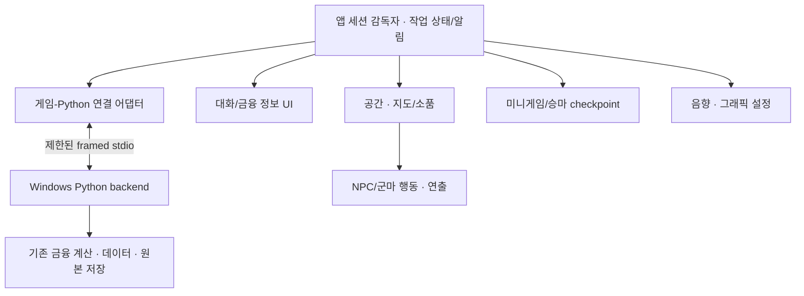

# ADR: 원정군 사령부의 UE5 채택과 Python 연결 검증

상태: **UE5 채택 확정 · 구체 버전/구현 방식/지원 사양 후속 검증 · 구현 전**. 조사일 2026-09-26, 채택 결정일 2026-09-27.
현재 요구/미술은 [사령부 사양](../expedition-headquarters/spec.md), 자산/권리/대형 파일 보관은
[자산 계획](../expedition-headquarters/assets.md)에 관리한다. [SF 기술 문서](command-bridge-rendering.md)는 폐기된 방향의 이력이다.

## 1. 저장소와 실제 환경

### 이번 저장소 확인

`/home/hansol/projects/phalanx`의 이번 문서 검토 시작 시 브랜치는 `design/command-bridge-spec`, HEAD는
`de77b6b41fde2a82753d70cf78eaef11a28449df`다. 로컬 `main`/`origin/main`과 이번
`git ls-remote origin refs/heads/main`의 원격 해시도 동일하다. tracked/staged 변경은 없고
검토 대상 설계 문서 6개와 보호 자료 5개가 미추적이었다. 앞선 설계 조사 시작 당시에는 기존
함교 설계 3개와 보호 자료만 미추적이었다. 관련 작업을 기존 브랜치에서 이어가며
새 브랜치/중복 worktree나 reset/clean/강제 checkout/stash를 사용하지 않았다.

저장소 및 `/`, `/home`, `/home/hansol`, `/home/hansol/projects`의 상위 `AGENTS.md`와
저장소 내부(숨김 디렉터리 포함, Git/venv/보호 자료 제외) 지침 경로를 조회했으며 적용할 파일이
발견되지 않았다. 기존 `docs/windows-desktop.md`와 코드·설계 문서를 읽었다. 사용자 자료 5개의
SHA-256을 앞선 작업 기준과 대조했고 이번 작업 전 baseline도 저장소 밖에 기록했다.

### Windows에서 직접 확인한 값

**2026-09-26 14:38–14:39 UTC / 23:38–23:39 KST**에 native PowerShell/CIM·DXGI·DPI·
`nvidia-smi`·PATH/설치 등록/manifest 조회를 새로 실행했다. 모든 native 조회 exit 0, 오류 4551
재현 없음. 실행 정책/설정 변경은 없었다. 다음은 장비 관측값이며 제품 최소 사양이 아니다.

| 항목 | 이번 관측값과 한계 |
|---|---|
| 장비/OS | HP OMEN MAX Gaming Laptop 16-ak0xxx, Windows 11 Home 64-bit 10.0.26200 |
| CPU/RAM | AMD Ryzen AI 7 350, 8 cores/16 logical processors. RAM 17,179,869,184 bytes ×2 =32 GiB, OS 가시 약31.29 GiB |
| 외장 GPU/driver | NVIDIA GeForce RTX 5070 Ti Laptop GPU /592.82 |
| VRAM | DXGI DedicatedVideoMemory 12,524,191,744 bytes =11,944 MiB; nvidia-smi total 12,227 MiB. API별 원값 유지, 같다고 보정하지 않음 |
| 내장 GPU | AMD Radeon Graphics, dedicated 512 MiB. shared system memory를 외장 VRAM처럼 더하지 않음 |
| 화면/DPI | 활성 1개, 2560×1600, WMI 60 Hz, 작업영역 2560×1528, DPI 144=150% |
| 렌더 어댑터 | 화면 모드는 AMD에 연결되어 보고됨. 실제 UE RHI/선택 GPU/feature level은 실행하지 않아 미확인 |
| 전원/열 | AC, Balanced, 배터리100%, 절전flag0. GPU power.limit N/A, API default80/min5/max140 W는 실효 TGP가 아님. 유휴순간4.94 W, 지속 부하/열 제한 미측정 |
| C: 공간 | 총1,022,658,342,912 bytes, 여유867,062,120,448 bytes. 실제 엔진/콘텐츠 설치 용량은 별도 산정 |
| Windows 런타임 | native Python3.12.14(기존 임시 검토용 venv), PowerShell5.1.26100.9444, WebView2 154.0.4258.37. 제품 배포판은 아님 |
| Unreal/Epic | PATH·표준폴더·설치 등록·LauncherInstalled.dat·HKLM/HKCU build registry에서 미발견. 설치/버전 미확정 |
| VS/MSVC/Windows SDK | 표준 VS/vswhere·Windows Kits/10·installed roots·cl.exe PATH에서 미발견. 버전 미확정. VS Code1.139.1은 C++ toolchain 증거가 아님 |
| 별도 WSL | Linux6.18.33.2-microsoft-standard-WSL2, system/프로젝트 Python3.12.3, uv0.12.5. Windows compiler/runtime/venv와 공유하지 않음 |

휴대용·사용자 지정·소스 빌드 경로는 전수 탐색하지 않았다. 미발견을 PC 전체 미설치로 단정하지
않는다. UE 실행·Lumen/cloth/인물/장면 성능·실효 GPU budget·패키징·청취는 미검증이다.
현재 노트북을 초고사양 제품 목표 충족의 증거로 쓰거나 미래 보급형 성능으로 환산하지 않는다.

조회 원본/명령/시각/오류는 저장소 밖 `/tmp/phalanx-expedition-headquarters-design/`의
`windows-hardware`, `windows-dxgi-dpi`, `windows-tools`, `windows-power`, `windows-engine-sdk`
관련 파일과 `wsl-tools.json`에 보관했다. `environment-evidence-SHA256.txt` 자체 SHA-256은
`b9a3ef00eaf3df517bc72c6efdf6c0dbd45eda1f1f54e18e2b9a37f14ed56818`이다.
과거 함교 조회의 디스크 여유878,602,764,288 bytes와 이번 값을 구분한다. 임시 증거는 제품 자산이 아니다.

사용자 지정 설치가 있다면 다음 **조회만** 추가하면 된다. 실제 경로를 알기 전 placeholder를 실행하지 않는다.

```powershell
Get-Content '<actual-UE-root>\Engine\Build\Build.version'
$phalanxVswhere = "${env:ProgramFiles(x86)}\Microsoft Visual Studio\Installer\vswhere.exe"
if (Test-Path $phalanxVswhere) { & $phalanxVswhere -all -products '*' -requires Microsoft.VisualStudio.Component.VC.Tools.x86.x64 -format json }
Get-ChildItem "${env:ProgramFiles(x86)}\Windows Kits\10\Include" -ErrorAction SilentlyContinue
```

다른 PC를 검증할 때의 최소 장비 조회는 다음이다. 큰 VRAM을 `AdapterRAM`만으로 판정하지 않는다.

```powershell
Get-CimInstance Win32_OperatingSystem | Select-Object Caption,Version,OSArchitecture
Get-CimInstance Win32_Processor | Select-Object Name,NumberOfCores,NumberOfLogicalProcessors
Get-CimInstance Win32_PhysicalMemory | Select-Object Capacity,Speed
nvidia-smi --query-gpu=name,memory.total,driver_version,power.limit --format=csv
Get-CimInstance Win32_LogicalDisk -Filter "DriveType=3" | Select-Object DeviceID,Size,FreeSpace
```

## 2. UE5 채택 결정과 후속 검증

**2026-09-27 사용자 결정으로 팔랑크스 게임 클라이언트 엔진은 Unreal Engine 5(UE5)로 최종
채택했다.** 기존의 우선 검증 후보·최종 채택 미확정 상태를 이 결정으로 갱신한다. 이 결정은
실행 검증 결과가 아니며, 아래 항목의 완료를 뜻하지 않는다.

| 항목 | 현재 결정과 후속 확인 |
|---|---|
| 게임 클라이언트 엔진 | **UE5 채택 확정**. 후속 T0/P0를 UE5로 진행 |
| 구체 엔진 버전 | 정확한 UE patch·플러그인 조합 미선정. 공식 호환 범위와 실제 빌드로 고정 |
| Windows 개발환경 | 확인된 노트북을 첫 환경으로 사용. 실제 UE/VS/MSVC/SDK 경로·버전과 빌드 가능 여부는 후속 확인 |
| Python 연결 | 기존 Python 계산·Decimal 처리·원본 저장을 유지. 별도 native Windows Python과 framed stdio는 검증할 연결 설계안 |
| 패키징 | UE 실행본과 backend bundle의 구성·의존성·종료를 실제 Windows 패키지에서 검증 |
| 성능·지원 사양 | 대표 장면과 실제 분석을 함께 측정한 뒤 설정별 성능 목표·최소/권장 지원 범위를 결정. 현재 측정 완료나 성능 보장 없음 |

다음 표의 왼쪽은 **공식 문서상 기능/제약**, 오른쪽은 **팔랑크스에 대한 설계 판단**이다.
기능 존재가 미술 품질·생산성·실제 장비 성능을 보장하지 않는다.

| 공식 근거 | 사령부에 적용할 판단/불확실성 |
|---|---|
| [Control Rig](https://dev.epicgames.com/documentation/unreal-engine/how-to-create-control-rigs-in-unreal-engine), [Animation Blueprint](https://dev.epicgames.com/documentation/unreal-engine/animation-blueprints-in-unreal-engine) | 지도 지시·시선·자세 전이와 손/탁자 접점을 하나의 제작 과정에서 다듬을 수 있어 채택 방향의 제작 도구로 적합하다고 판단. 최종 방향 인물/rig 확보와 수작업 보정 필요 |
| [Chaos Clothing Tool](https://dev.epicgames.com/documentation/unreal-engine/clothing-tool-in-unreal-engine) | 천막/군기/복식의 필요한 부분에 시뮬레이션 적용 후보. 고정점·충돌·관통·CPU 비용은 별도 검증 |
| [Lumen](https://dev.epicgames.com/documentation/unreal-engine/lumen-global-illumination-and-reflections-in-unreal-engine) | 석양·천막·청동의 동적 간접광/반사 후보. Lumen GI와 정적 lightmap GI를 동시에 쓴다고 설계하지 않음. 실제 선택 방식별 화면과 비용 측정 |
| [Niagara](https://dev.epicgames.com/documentation/unreal-engine/overview-of-niagara-effects-for-unreal-engine) | 불꽃·연기·먼지를 다른 emitter/system으로 구성 가능. 반투명 overdraw와 light 수는 초고사양 목표에서도 예산 필요 |
| [UMG/Composite Font](https://dev.epicgames.com/documentation/unreal-engine/font-asset-and-editor-in-unreal-engine) | 현대 한글 데이터층을 공간과 별도로 구성. 실제 glyph·복사·키보드·DPI는 Windows 패키지에서 검사 |
| [Python Editor 플러그인](https://dev.epicgames.com/documentation/unreal-engine/scripting-the-unreal-editor-using-python) | Editor 자동화용이며 PIE/Standalone/cooked 제품 runtime에 사용 불가. 제품 분석 서비스는 별도 native Windows Python 유지 |
| [패키징](https://dev.epicgames.com/documentation/unreal-engine/packaging-your-project), [VS 설정](https://dev.epicgames.com/documentation/unreal-engine/setting-up-visual-studio-development-environment-for-cplusplus-projects-in-unreal-engine) | build/cook/stage/package 후 에디터 없이 실행해야 함. 현재 도구 미확정이므로 아직 빌드 가능 판정 안 함 |

조사 시 공식 문서는 UE5.8 계열을 제공하며 C++ 도구 표에는 VS2022 17.14+ 또는 VS2026,
MSVC 최소14.38, Windows SDK 최소10.0.22621.0이 안내돼 있다. 이는 **개발 도구 안내**이며
현재 설치값/제품 최소 사양이 아니다. 후속 착수 시 선택한 UE의 정확한 patch와 지원 SDK/MSVC,
플러그인 버전을 고정한다. 최신 엔진 무조건 채택이나 대형 설치는 이번 작업에 포함하지 않는다.

**구현 설계안:** 채택한 UE5에서 UMG + 별도 native Windows Python backend를 검증한다.
먼저 자산 없는 T0에서 실제 계산·표시·정상 종료를 확인하고, 이후 기존 사령부 시제품(P0)에
통합한다. 인물·천·빛·효과의 제작 도구가 이번 미적 위험을 시험하기에 적합하다는 판단이며,
이 판단만으로 실제 품질·성능을 통과시키지 않는다. 기존 Python 정확성은 유지하고 연결/표시
어댑터를 추가해 책임을 분리한다.

Unity/Godot/WebView의 과거 비교는 이력으로 보존한다. 후속 실험은 채택한 UE5에서 구체적인
연결·배포·제작·품질·성능 조건을 확인하는 단계다.
보급형 대응을 이유로 사령부 미술 목표를 먼저 낮추지 않으며, 초고사양 목표 역시 무제한
광원·texture·cloth 비용을 허용한다는 뜻은 아니다.

[Epic 라이선스 안내](https://www.unrealengine.com/license)와 [EULA §3·4·6](https://www.unrealengine.com/eula/unreal)의
실제 배포·과금·매출·예외에 따라 royalty/seat 적용을 확인한다. 금융 앱이라는 이유로 무조건
seat, 게임처럼 보인다는 이유로 무조건 무료라고 판단하지 않는다. 현재 배포/사업 조건은 미정이다.
엔진 계약과 Fab/MetaHuman/음원 등의 개별 자산 권리는 별도이며 취득/배포 전 기록해야 한다.

## 3. 실제 코드 경로와 재사용 범위

기존 Windows Desktop은 동작하는 금융 기반이다. 새 게임 장면이나 AI 연결의 증거는 아니다.
[현재 Windows 사용/검증 문서](../windows-desktop.md)는 제품 코드 계약의 상세 근거로 유지한다.

| 현재 구현 | 재사용할 계약 | 새 게임 경계에서 필요한 작업 |
|---|---|---|
| [__main__](../../src/phalanx/desktop/__main__.py), [runtime.main/NativeBridge](../../src/phalanx/desktop/runtime.py) | Windows 주 스레드 창, native chooser·opaque token, narrow API | 새 native launcher/chooser/IPC. `python -m phalanx.desktop`은 WebView 창을 열므로 backend 실행 명령으로 사용하지 않음 |
| [DesktopApplication](../../src/phalanx/desktop/application.py) | 단일 non-daemon worker, generation/job, 중복 거절·재조회·종료 대기 | `_complete`의 HTML 결합을 DTO presenter로 분리. 현재 `_start`는 원본을 교체하므로 장기 결과 registry 추가 필요 |
| [AllocationInputService](../../src/phalanx/portfolio/allocation_input/service.py), [AllocationTargetsService](../../src/phalanx/portfolio/allocation_targets/service.py) | selection bytes 한 번 고정, `calculate_bytes`, 기존 계산/진단/provenance | 그대로 호출. 준비를 중복 실행하거나 금융 로직을 C++/Blueprint/JS에 복제하지 않음 |
| [WindowsHistoryRepository](../../src/phalanx/market_data/history/windows_repository.py), [HistoryReader](../../src/phalanx/market_data/history/reader.py) | 닫힌 로컬 SQLite export, read-only/immutable·공통 schema 검증·한 read snapshot | 엔진은 SQLite를 직접 열지 않음. WSL 공유 경로를 제품 필수 입력으로 만들지 않음 |
| [Decimal context](../../src/phalanx/decimal_math.py) | precision50/HALF_EVEN·traps, 기존 NumPy float64 통계/최적화 경계 | 모든 계산이 Decimal이라고 주장하지 않음. 화면에는 exact 문자열, 시각화 좌표는 별도 |
| [storage.store_result](../../src/phalanx/desktop/storage.py), [Windows files](../../src/phalanx/platforms/windows_files.py) | 원본 bytes·private ACL·상위 guard·flush/atomic rename·no-overwrite·실패 정리 | 엔진/AI는 원본 재직렬화·임의 파일 쓰기 금지. raw bytes는 Python 소유 |
| [FormationRoomModel](../../src/phalanx/portfolio/formation_room/model.py), [parser](../../src/phalanx/portfolio/formation_room/parser.py) | 검증된 표시 모델·이름/provenance 연결·시나리오/진단 | 복사/직렬화한 DTO → UMG. 현재 HTML renderer는 기존 소비자로 유지 |
| [shell](../../src/phalanx/desktop/assets/shell.js), [runtime lifecycle](../../src/phalanx/desktop/runtime.py) | 조회 오류 시 같은 작업 재조회, 늦은 응답 차단·무음·정상 종료 | scene/NPC/놀이 수명과 앱 종료를 분리. 미지원 계산 취소를 UI에 만들지 않음 |

현재 `open_result`는 원본 JSON을 읽어 표시하며 재계산하지 않는다. `calculate`는
`AllocationTargetsService(AllocationInputService(WindowsHistoryRepository(db))).calculate_bytes(selection_bytes)`를
호출한다. `_complete`가 파싱/HTML을 만들고 `save_result`가 당시 bytes를 저장한다.

현재 계산 취소 API는 없다. 파일 대화상자 취소와 계산 취소는 다르다. `request_close`는
`_closing=True` 후 작업/저장이 끝날 때까지 닫기를 지연하며 `closed`는 worker를 join한다.
조회 timeout/오류는 취소가 아니다. `state=error` 운영 실패와 `partial/failed/input_unavailable`
같은 금융 결과 상태를 구분한다. 지금은 최신 결과 하나뿐이며 과거 결과 복귀는 새 설계다.

WebView 경로의 `sandbox="allow-scripts"` srcdoc, same-origin/탐색/CSP·파일 경계는 유지한다.
3D 때문에 임의 file/CDN/로컬 드라이브 접근을 열지 않는다. native UE는 패키지 소유 자산만 로드하고
금융 JSON/DB·설정·권리 문서/원본 아트 경로를 scene asset 경로와 분리한다.

### 책임과 수명



첫 구현은 이 책임에 맞는 작은 모듈/명시적 메시지로 충분하다. 범용 plugin framework·분산
서비스·참모별 backend를 먼저 만들지 않는다. AI 도구 요청도 공통 작업 관리자와 Python으로
모으고, 행동/연출은 결과 이벤트를 소비할 뿐 계산 완료/성공을 결정하지 않는다.

## 4. Python 프로세스와 연결 권고

| 방식 | 장점 | 필요한 책임/제약 | 판단 |
|---|---|---|---|
| 익명 pipe의 framed stdin/stdout | 단일 UE 부모와 Python 자식, 포트/서버 탐색 없음 | framing·부분 읽기·역압력·핸들 상속/EOF, stdout 로그 금지. Win32 anonymous pipe는 overlapped I/O 미지원 | **첫 실험 권고** |
| Windows named pipe | 독립 서비스 재접속·다중 client·overlapped I/O의 확장 여지 | 세션 이름·명시 DACL·remote client 거부·상대 검증·lifecycle 필요 | 독립 서비스 수명이 필요해질 때 재검토 |
| loopback HTTP | 진단/도구 호환·여러 client | 포트/서버 수명·인증·Origin/Host·요청 상한. localhost만으로 신뢰하면 안 됨 | 현재 단일 자식 실험에는 불필요한 범위 |

[Win32 anonymous pipe](https://learn.microsoft.com/en-us/windows/win32/ipc/anonymous-pipe-operations),
[자식 표준 입출력 연결](https://learn.microsoft.com/en-us/windows/win32/procthread/creating-a-child-process-with-redirected-input-and-output),
[named pipe 보안](https://learn.microsoft.com/en-us/windows/win32/ipc/named-pipe-security-and-access-rights),
[CreateNamedPipe](https://learn.microsoft.com/en-us/windows/win32/api/winbase/nf-winbase-createnamedpipea)를 근거로 비교했다.
이는 공식 API 특성에 기초한 설계 판단이며 현재 IPC 구현이 있다는 뜻은 아니다.

UE의 [CreateProc](https://dev.epicgames.com/documentation/unreal-engine/API/Runtime/Core/FGenericPlatformProcess/CreateProc) 계열로
패키지 안의 고정된 backend 실행 파일을 띄우는 안을 검증한다. 정확한 UE patch에서의
실행 파일/표준 핸들 연결·binary I/O·stderr 배수는 아직 실행 검증하지 않았다. T0에서
Editor 연결과 패키징한 Windows 앱을 따로 확인하며 API 문서만으로 성공을 단정하지 않는다. 필요한 pipe end만 상속하고 나머지를 닫는다.
**전용 blocking I/O 스레드 + game thread 전달 큐**를 두고 게임 스레드에서 읽기/쓰기/프로세스
종료를 기다리지 않는다. 길이 헤더/본문은 raw byte로 부분 읽기/쓰기를 누적하며 문자열/줄 단위
pipe 함수로 대체하지 않는다. stderr도 별도로 배수해 교착을 막고 개인정보/원본 payload는 로그에서 제외한다.

### 메시지와 재조회 의미

아래 framed stdio와 프로세스/상태 계약은 **구현 전 검증할 설계안**이다. 이번에는 IPC 코드나
범용 프레임워크를 작성하지 않는다. T0에서는 실제 계산 한 건에 필요한 명령만 구현·검증한다.

| 계약 | 제안 |
|---|---|
| handshake | protocol version·앱 세션 ID·지원 명령/상한·`cancel_supported=false` 교환. 불일치 시 진단 후 계산 차단 |
| framing | 4-byte little-endian 길이 + UTF-8 JSON, control64KiB/DTO4MiB를 첫 실험 상한으로 협상. 초과/잘린 frame/알 수 없는 명령은 오류. 원본 JSON32MiB 입력 한도와 구분 |
| 식별 | `session_id`, 명령별 `request_id`, 작업 `job_id/generation`, 결과 `result_id`, snapshot `revision`. 장면은 별도 `scene_epoch` |
| 명령 | 선택 파일 등록/token, open_result, calculate, job_status, result 조회/저장, close 단계. shell/eval/범용 경로 읽기 없음 |
| 중복 | 같은 request ID+동일 요청은 접수 ledger의 같은 job/응답 반환. 다른 내용으로 ID 재사용은 오류. 실행 중 새 계산은 호출자 ID/generation을 보존해 거절하고 active job은 별도 필드 |
| 진행/완료 | accepted→running→terminal. 실제 단계만 표시. terminal에 결과 생성 여부·금융 상태·저장 상태를 분리. 오류를 성공 애니메이션으로 덮지 않음 |
| 늦은 응답 | 다른 세션/낡은 revision은 현재 화면에 적용하지 않음. 폐기된 scene callback만 epoch로 차단하고 유효한 job 완료는 앱에 반영 |
| 데이터/파일 | 금액/비중은 exact 문자열. Python에 raw bytes/해시 유지. native chooser만 승인한 경로를 등록하고 Python이 경로 종류·ACL/guard를 재검증 |
| 취소 | 실행 중 금융 작업 취소는 미지원. 입력 chooser 취소·화면 이동·대화 취소·놀이 정지는 별개 |

최초 accepted 응답 유실로 job ID를 아직 모르면 **같은 최초 request ID와 동일 내용**을 재전송해
접수 ledger에서 원래 job ID를 복구한다. 이미 job ID를 받았다면 **새 조회 request ID로 같은 job**을
조회한다. 각 논리 요청은 새 request ID를 가지며 그 요청 자체의 재전송만 같은 ID를 쓴다.
조회 응답 유실 시 이전 응답을 복구한 뒤 최신 상태가 필요하면 다시 새 조회를 보낸다. 자동 새 계산은 금지한다. 연결이 살아 있는 동안 구독/UI만 재생성되면 snapshot을
다시 받는다. 익명 pipe의 EOF/child crash 뒤에 같은 child에 재접속할 수 있다고 약속하지 않는다.
실제 연결 단절은 오류로 표시하고 부모/자식 정리 후 새 세션으로 시작한다. 이전 작업은 자동
재실행하지 않으며 저장 파일 재열기만 보장한다. 재접속이 필요한 독립 서비스는 named pipe와
별도 지속성 계약을 다시 설계한다. ledger/큐는 상한을 두고 활성 요청을 조용히 제거하지 않는다.

### 작업과 화면의 수명 계약

앱 세션(UE GameInstance 계열의 감독자)이 Python 연결·작업 조회·알림·결과 선택을 소유한다.
scene/NPC 대화/놀이/군마의 생성·파괴는 backend close나 job generation 증가를 유발하지 않는다.
현재 작업 제어가 이를 자동 지원하는 것은 아니다.

T0와 P0는 각각 한 작업/한 결과로 제한한다. 결과를 저장/명시적으로 정리하기 전 새 계산으로 덮어쓰지
않도록 접수 경계를 둔다. 여러 공간 단계에는 **Python 소유 결과 registry**가 필요하다. 원본 bytes·
provenance·DTO·저장 상태를 result ID로 유지하고 active job과 selected result를 분리한다.
미저장·표시/알림/저장 대기에서 참조한 결과는 자동 삭제하지 않는다. 건수/bytes 상한에 닿으면
기존 결과를 지우지 않고 새 작업을 거절한다. 금융 `failed/partial`도 원본이 있으면 보존한다.
이 다중 결과 기능을 첫 실험에 이미 구현된 것으로 보고하지 않는다.

terminal 결과 확정 후 안정된 알림 ID를 발행한다. 결과 없는 운영 실패도 terminal 요약에 남기고
같은 연결의 재조회로 유실/중복 알림을 복구한다. 알림 선택은 그 result ID/실패 job을 고정하고,
실제 표시 후 읽음 처리한다. 새 결과로 몰래 바꾸지 않는다.

장기 놀이/승마 checkpoint에는 instance/schema/revision, 논리 tick·진행/남은 시간·RNG·복귀 위치를
보관한다. 입력 차단/눌림 해제→현재 tick 완료→checkpoint 확정→scene unload, 재개는 검증→
자산 준비→상태 복원→사용자 재개 순서다. 결과 알림 이동 시 같은 계약을 쓴다. 정지 동안 놀이
시간이 흘러가거나 복귀 때 누적 physics가 한꺼번에 실행되면 실패다. 원본 금융 결과를 놀이 저장에
섞지 않는다. crash/재부팅 후 미저장 결과·놀이 복구는 이번 약속에 포함하지 않는다.

정상 앱 닫기는 `close_intent`에서 새 계산/활동을 막고 현재 작업을 기다린다. 완료 결과의
저장/명시적 버리기/종료 취소를 처리한 뒤 `close_requested`에서 모든 새 명령을 막고 기존
worker·파일 정리→backend ACK/exit→창 종료로 진행한다. 되돌릴 수 없는 현재 `request_close`는
취소 가능한 단계에 먼저 호출하지 않는다. 대기 시간 초과는 진단이지 강제 금융 취소가 아니다.
부모 crash/EOF 때 자식은 새 요청 차단 후 진행 작업을 정리하고 종료한다. OS 강제 종료·정전의
미저장 복구는 보장하지 않는다. 창만 닫고 고아 프로세스를 남기는 실패를 따로 검사한다.

### Windows 배포

[PyInstaller](https://pyinstaller.org/en/stable/operating-mode.html)의 Windows **onedir**로 만든
headless backend를 UE 패키지에 동봉하는 안을 권고한다. native Windows Python과 동일 lock으로
빌드하고 pywin32·NumPy/scikit-learn 및 실제 DLL/데이터/고지를 포함해 검증한다. 사용자가
WSL·Python·개발 venv를 설치해야 하는 제품 구조로 만들지 않는다. 별도 runtime 설치가 필요한
UE redistributable 등은 패키지/설치 단계에서 확인한다.

stdio를 쓰므로 console bootloader를 사용하고 UE launcher가 콘솔 창 없이 표준 핸들을 연결하는
실행 방식을 검증한다. [`--windowed/--noconsole`](https://pyinstaller.org/en/stable/common-issues-and-pitfalls.html#sys-stdin-sys-stdout-and-sys-stderr-in-noconsole-windowed-applications-windows-only)은
Windows의 stdin/stdout/stderr가 None이 될 수 있어 그대로 적용하지 않는다. Python Editor 플러그인,
WSL 명령, 기존 `phalanx.desktop` GUI bootstrap은 backend의 대체물이 아니다.

## 5. 첫 실험의 실행 절차

이번 문서 검토·등록에서는 **실험을 실행하지 않는다**. 제품 코드/fixture/의존성/lock 수정도 없다.
다음 구현은 T0 기술 연결 검증을 먼저 하고 기존 P0 사령부 시제품으로 이어간다. 범위는 [사양의 첫 실험](../expedition-headquarters/spec.md#7-작은-첫-실험과-단계별-사용할-수-있는-버전)과 같다.

### 재현 입력과 정답 생성

[selection.json](../../tests/fixtures/desktop/selection.json)과
[history-view.json.gz](../../tests/fixtures/desktop/history-view.json.gz)를 고정 입력으로 사용한다.
[desktop_helpers.desktop_inputs](../../tests/desktop_helpers.py)는 여섯 합성 종목·505 관측치를
Windows 호환의 닫힌 SQLite DB로 만드는 **테스트 전용** helper다. 제품이 DB를 생성하는 기능은 아니다.
`portable_history_helpers`의 3종목/1일 자료로 성공 계산을 대신하지 않는다.

후속 Windows 검증 checkout의 루트에서, 같은 lock으로 준비한 native Python을 명시해 아래를
실행한다. `<native-python.exe>`는 실제 검증 경로로 치환한다. 별도 고유 TEMP 폴더만 생성하며
사용자 자료/기존 출력은 덮어쓰지 않는다. fixture fingerprint를 플랫폼에 맞춰 고쳐 쓰지 않는다.

```powershell
@'
import hashlib
import json
import sys
import tempfile
from pathlib import Path

root = Path.cwd()
sys.path.insert(0, str(root / "tests"))
from desktop_helpers import desktop_inputs
from phalanx.market_data.history.windows_repository import WindowsHistoryRepository
from phalanx.portfolio.allocation_input.service import AllocationInputService
from phalanx.portfolio.allocation_targets.service import AllocationTargetsService
from phalanx.desktop.storage import store_result

work = Path(tempfile.mkdtemp(prefix="phalanx-headquarters-"))
database, selection = desktop_inputs(work / "inputs")
service = AllocationTargetsService(AllocationInputService(WindowsHistoryRepository(database)))
expected = service.calculate_bytes(selection.read_bytes()).to_json_bytes()
store_result(work / "expected.json", expected)
print(json.dumps({
    "work": str(work), "database": str(database), "selection": str(selection),
    "selection_sha256": hashlib.sha256(selection.read_bytes()).hexdigest(),
    "database_sha256": hashlib.sha256(database.read_bytes()).hexdigest(),
    "expected_sha256": hashlib.sha256(expected).hexdigest()
}, ensure_ascii=False, indent=2))
'@ | & '<native-python.exe>' -
```

현재 원본에 실행 시각/UUID를 매번 추가하지는 않는다.
현재 [계산](../../src/phalanx/portfolio/allocation_targets/calculation.py)의 calculation_date는 입력의
used_end이며 controller job UUID는 [원본 serializer](../../src/phalanx/portfolio/allocation_targets/serialization.py)에
들어가지 않는다. 같은 OS/Python/lock·BLAS/thread 설정·고정 입력의 직접 서비스와 backend는
raw bytes/SHA가 같아야 한다. Linux 정답을 Windows 정답으로 대신하거나 fingerprint·숫자 반올림·
시각 제거로 불일치를 숨기지 않는다. 환경이 다른 재계산의 bitwise 동일성은 별도 문제다.

### T0 · 빈 장면의 기술 연결 검증

선행 준비는 선택한 UE patch와 호환 C++/Windows SDK, native Windows Python/기존 lock 환경,
위 공개 합성 입력, 확인된 개발 노트북이다. **유료 자산·외주·DCC·완성 인물/천막·음향은 필요하지
않다.** 기존 익명 pipe/framing 권고를 검증하며 범용 통신 framework나 다중 결과/NPC 시스템을
미리 만들지 않는다.

1. 빈 UE 장면 또는 임시 도형에 최소 상태/결과 텍스트 UI를 둔다. 검증용 합성 selection/DB만
   고정 등록하고, 별도 native Windows Python에서 기존 `calculate_bytes`를 실제 호출한다.
2. 시작/handshake→요청 접수→실제 계산→정확한 결과 문자열 표시→정상 닫기의 한 경로를 만든다.
   직접 서비스의 raw bytes/SHA·표시 값과 비교한다. Editor Python·mock 완료·sleep은 실제 계산을 대신하지 않는다.
3. 길이 헤더/본문의 분할 읽기·쓰기, 크기 초과/잘린 frame, 잘못된 메시지, request/job 식별과
   중복·응답 유실, stderr 배수, child 오류를 검사한다. 창 닫기는 계산을 취소한 척하지 않고
   작업 정리와 child exit를 기다리며 고아 프로세스를 남기지 않아야 한다.
4. Editor/PIE의 개발 연결은 별도 기록한다. 이후 빈 장면도 **Windows packaged exe + native
   backend bundle**로 검사하고 에디터/WSL/개발 venv 없이 계산·표시·정상 종료를 반복한다.
   둘 중 하나가 미완료면 해당 판정은 미검증이며 T0 전체 통과로 보고하지 않는다.

T0는 이 기술 경로의 검증이다. 사용자가 결과를 버릴지 선택할 수 있어야 하며 기존 Python
원본 저장을 재사용한다. 완성된 파일 선택/열기·저장·재열기 화면은 P0에서 아래와 같이 통합한다.
T0의 FPS/메모리를 사령부 부하나 지원 사양으로 일반화하지 않는다. 미술·음향·실제 청취는 T0의
합격 조건이 아니며 미검증으로 표시한다. 장면 자산 없이 시작할 수 있어도 UE/도구 설치와
실험 실행 자체는 이번 커밋 작업에 포함하지 않는다.

### P0 · 기존 사령부 시제품의 구현·검증 순서

1. T0 결과를 확인한 뒤 DCC·P0 권리/자산·PC/해상도/품질 프로필을 고정한다.
2. 기존 범위인 천막 부분·헤파이스티온 한 명·지도 한 개·야영지 일부를 만들고 정지 미술/동작을 검토한다.
3. T0의 headless bootstrap·pipe·DTO/UMG를 통합한다. native chooser에서 위 selection/DB를
   선택하고 지도에서 계산 요청→실제 처리 단계→네 시나리오/진단을 표시한다.
4. 새 경로로 원본 저장→창/프로세스 정상 종료→새 프로세스에서 저장 JSON과 selection 재열기.
   bytes·해시·기업명 연결·정확한 문자열/금융 상태가 직접 서비스와 같아야 한다.
5. 사령부 Windows packaged 실행본을 native 로컬 경로에서 검증한다. Editor/PIE·WSL·개발 venv에
   의존하지 않는 실행 환경 검사와 실제 파일 대화상자·한글/공백 경로를 포함한다.

아래 세 합격 기준은 **P0 사령부 시제품**의 판정이다. T0 기술 통과가 이를 대체하지 않는다.

### 1) 기능 합격

- 실제 계산/원본 저장/재열기의 bytes·SHA, 시나리오 순서·상태·exact 값이 동일하다. 입력 해시도 불변.
- 무효 selection/DB·접근 오류·저장 충돌은 기존 서비스/저장 계약과 같은 실패 의미를 보인다.
  저장 실패 후 원본이 남아 다른 이름으로 재시도된다. ACL/상위 guard/no-overwrite를 유지한다.
- 이중 클릭·응답 유실·조회 실패·오래된 session/generation/revision을 검사한다. 중복 실행/자동
  재계산/성공 오표시가 없으며 연결이 살아 있는 timeout/조회 실패는 동일 job 재조회로 복구한다.
- EOF/child crash는 오류 표시→프로세스 정리→새 세션→저장 파일 재열기로 검사한다. 죽은 child의
  작업 재조회나 미저장 결과 복구를 약속하지 않고 자동 재계산하지 않는다.
- idle/계산 중/저장 중 닫기, 종료 대기 중 결과 저장/종료 취소, 최소화/복원, 새 프로세스 재열기
  각 경계를 확인한다. 현재 없는 실행 중 금융 취소 기능을 성공 기준에 넣지 않는다.
- 참고 회귀: [application](../../tests/test_desktop_application.py), [bytes](../../tests/test_allocation_bytes.py),
  [runtime](../../tests/test_desktop_runtime.py), [Win32 files](../../tests/test_windows_files.py),
  [Windows DB](../../tests/test_windows_history_repository.py). 새 어댑터/패키지 검증이 필요하며 과거 통과를 대신하지 못한다.

### 2) 운영·성능 합격 절차

측정 전 지원 사양을 확정하지 않는다. 확인된 개발 노트북에서 시작하되 초고사양 제품 목표를
이 장비가 충족한다고 가정하지 않는다. 추후 실제 목표 PC가 정해지면 같은 절차로 반복한다.
제품 지원은 측정한 PC/장면/분석 규모/프로필 범위로만 결정하며 5년 뒤 보급형 지원을 예측하지 않는다.

| 고정/계측 항목 | 절차 |
|---|---|
| 해상도/DPI | 우선 개발 장비의 물리2560×1600·150%를 기록. borderless 실제 client/render 픽셀과 일반 창 작업영역2560×1528을 혼동하지 않음. 다른 해상도/상위 PC는 별도 측정 |
| 그래픽 | 고급/기본의 RHI·실제 adapter·GI/반사·shadow·cloth/hair·LOD/mip·효과·AA·vsync를 각각 기록. Lumen GI와 baked GI는 같은 프로필로 합산하지 않음 |
| frame | frame generation/upscaling off·render scale100%를 초기 비교 조건으로 고정. 변경 시 별도 결과. 60초 warm-up 후 5분×3회 CPU game/render·GPU work·present P50/P95/P99/최악 hitch |
| 메모리 | UE+Python/자식의 Private Bytes/working set, 시스템 RAM/commit/page fault, GPU local/shared usage·WDDM budget·장면 로딩 peak. 공유 메모리 중복 합산 금지 |
| 분석/반응 | request→accepted·지도 반응·terminal→표시 지연과 총 계산 시간을 별도 측정. 실제 native 수치 라이브러리 thread 수/BLAS 설정도 기록 |
| 유지/종료 | 30분 유지와 열기/계산/저장/복원20회, child·thread·handle·메모리 추이. 결과 보존 수를 고정하고 증가가 계속되면 누수 조사. crash/OOM/device loss/고아 process가 없어야 함 |

프로필별 목표 fps F, frame budget `1000/F ms`, P95/P99·hitch 허용치·RAM/VRAM 상한·입력 지연·
분석 시간 악화 허용비 R은 실제 PC와 단독 기준을 확인한 뒤 **동시 실행 판정 전에** 기록한다.
지금 숫자를 제품 최소 사양이나 성능 보장으로 쓰지 않는다. 기본/고급은 각각 미술 검토도 통과해야 한다.

측정 행렬은 (a) 게임 없이 같은 backend/작은 harness의 실제 분석 `T_analysis`, (b) 분석 없는
사령부 동작, (c) 사령부+실제 분석 `T_concurrent`, (d) 분석 중 지도/UI 입력 반응 및 완료 직후
결과 UI·원본 저장,
(e) 분석 중 최소화→복원, (f) 기본/고급 각각 및 설정 전환이다. 렌더만 정지한 상주 게임은
별도 진단이며 분석 단독 기준이 아니다. 단일 worker가 BLAS thread 하나라는 뜻도 아니다.

실제 계산이 짧으면 반복 시 각 실행의 동시 구간을 따로 기록한다. idle 시간을 평균에 섞어
성능을 좋게 보고하지 않는다. 여섯 종목 fixture가 대표 부하를 설명하지 못하면 그 한계를 남기고
지원 범위 확정을 보류한다. 큰 합성 입력은 후속 부하 계획에서 범위를 고정한다. sleep/barrier는
오류 경계 검증 전용이며 실제 분석 부하의 대체물이 아니다.

CPU/메모리/IO·열 경쟁을 보고 thread budget, 자산 decode/upload 분할, 보이지 않는 NPC/cloth
업데이트와 효과 예산을 조정한다. 계산 정밀도·수식·solver 조건을 바꾸거나 분석을 중지해서
frame 목표를 맞추지 않는다. 설정 변경 시 같은 환경의 직접 Python 정답을 다시 확인한다.
[Unreal Insights](https://dev.epicgames.com/documentation/en-us/unreal-engine/unreal-insights-in-unreal-engine)와
[DXGI budget/usage](https://learn.microsoft.com/en-us/windows/win32/api/dxgi1_4/ns-dxgi1_4-dxgi_query_video_memory_info)를
함께 기록한다. 개발 에디터 trace와 제품 실행본 trace를 구분한다.

### 3) 미술 합격과 후속 사양 결정

[사양의 미술 완료 기준](../expedition-headquarters/spec.md#6-품질-단계와-미술-완료-기준)에 따라
구도·재질·조명·인물·반응·금융 정보·실제 청취를 판정한다. 기능·운영/성능·미술은 각각
`통과/실패/미검증`으로 남기고 서로 대체하지 않는다. UE5 채택은 사용자 결정으로 확정됐으며,
세 항목의 실측 결과와 제작 시간·권리·배포 비용을 바탕으로 구체 버전·구현 방식·품질 설정과
지원 사양을 정한다. 실험 결과를 다섯 참모·승마·대규모 야영지의 성능으로 확대 해석하지 않는다.
부케팔로스는 다음 독립 제작 단계다.

## 6. 조사 이력과 이번 문서 등록 범위

2026-09-26 초기 설계 조사에서는 코드/문서 읽기, native Windows 조회, 공식 자료 조사와 문서
작성·검증을 수행했다. 당시 staging·commit·push·PR은 하지 않았다. 이번 검토·제출은 지정된
여섯 설계 문서만 보완·검증하고 문서 커밋과 Draft PR로 등록하는 범위다. 환경 수치는 앞선
조사의 시각/출처를 유지하며 이번에 재측정한 것으로 보고하지 않는다. 2026-09-27 후속 사용자
결정인 UE5 채택 확정은 현재 사령부 문서 3개의 별도 후속 커밋으로 반영하고 같은 Draft PR을
갱신한다. 새로운 실행 검증 증거로 기록하지 않는다.

신규 게임·AI·Python IPC·Windows 패키지·frame 성능·실제 청취는 아직 실행하지 않았다.
제품/테스트/의존성/lock 변경, 엔진/도구 설치, 구매·대량 다운로드·게임 구현도 이번 범위 밖이다.
문서만 변경하므로 로컬 전체 pytest를 반복하지 않으며, 설정된 PR CI는 그대로 실행/확인한다.

다음 Windows UE5 개발환경 준비에는 사용자 지정 UE/VS 설치가 있다면 실제 경로 확인, 없다면
선택한 UE 버전과 호환되는 Visual Studio C++ workload/MSVC·Windows SDK 준비, Windows 로컬
검증 checkout과 native Python 환경 확보가 필요하다. 버전 호환은 위 공식 도구 표와 실제
설치 목록으로 확인한다. 이번에는 설치/변경 명령이나 문서 예제를 실행하지 않는다.

확인된 노트북을 T0의 첫 측정 환경으로 삼는다. P0 이후의 목표 PC/해상도·제작 인력/샘플 견적·
자산/배포 라이선스·대형 파일 보관 예산은 별도로 정한다. **이 제작 정보나 자산 확보를 T0의
선행 조건으로 두지 않는다.** 승인 2.5D 파일은 선택적 참고이며 기술 연결 검증에 필요하지 않다.
현재 git/문서 검증과 PR/CI 결과는 최종 제출 보고에 기록한다.
