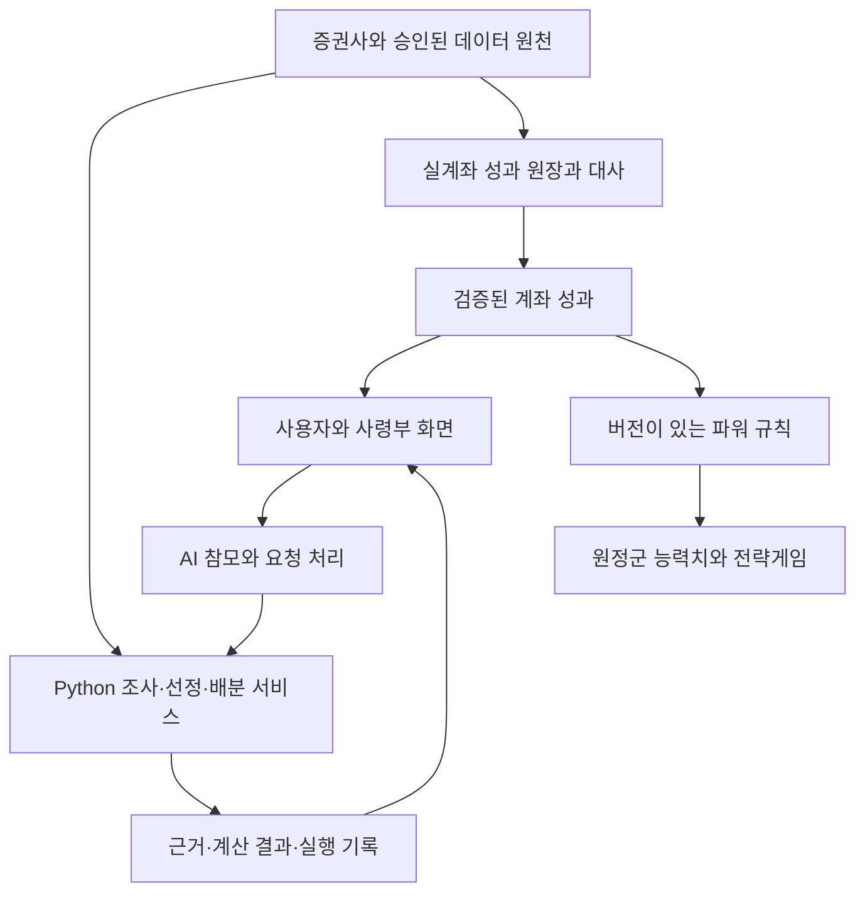

# Phalanx — 투자 플랫폼과 원정군 전략게임의 통합 비전

- 작성일: 2026-09-29 (한국시간)
- 상태: 제품 방향과 단계별 설계 기준. 구현 완료 보고서가 아니다.
- 범위: 투자 터미널, AI 종목 추천·자산배분, 대화형 참모, 실계좌 기반 게임 성장, 부대 지휘, 부케팔로스, 증권사 제휴.

2026-09-30 후속 설계: [네 엔진 아키텍처](four-engine-architecture.md)에 운용·연구·검증·감시의 책임과 첫 구현 범위를 정리했다. 해당 문서에는 2026-09-29 Godot 작업 스냅샷도 별도로 기록했다. 아래 구현 현황은 최초 작성 당시 기준을 유지한다.

## 1. 제품을 한 문장으로 정의한다

**팔랑크스는 게임엔진으로 구현한 아름다운 투자 터미널에 AI 투자 참모와 부대 지휘 전략게임을 결합하고, 실제 계좌의 자산과 검증 가능한 운용성과가 게임 속 성장과 경쟁으로 이어지는 Windows 데스크톱 플랫폼이다.**

사용자는 마케도니아 원정군의 사령관이다. 사령부에서 참모와 시장을 분석하고, 종목과 배분 전략을 검토하며, 원정군을 편성해 전장에서 지휘한다. 투자자로서 축적한 자본과 운용기록, 게임에서 쌓은 전술적 숙련이 각자의 방식으로 원정군의 경쟁력에 기여한다.

사용자가 표현한 목표는 **“게임엔진으로 만든 예쁜 MTS + 블룸버그 터미널에 게임까지 붙은 신종 프로그램”**이다. MTS·블룸버그라는 표현은 계좌·정보·분석·판단 기능의 통합과 사용성을 가리킨다. 첫 제품은 Windows 설치형이며, 모바일 동시 출시나 블룸버그의 전체 데이터 범위를 첫 개발 범위에 넣는다는 뜻은 아니다. 시장 최초라는 주장은 별도 경쟁제품 조사 전까지 확정하지 않는다.

장기적으로 제품의 완성도를 높여 특정 증권사와 제휴하고, 고객 대상 배포·운영을 공동으로 추진한다. 기존 Python 금융 엔진은 이 제품의 기반으로 계속 발전시킨다.

## 2. 결정의 수준과 이전 계획과의 관계

### 2.1 이번 대화에서 정한 방향

| 항목 | 제품 기준 |
| --- | --- |
| 제품 정체성 | 게임엔진 기반 투자 터미널, AI 투자 기능, 전략게임을 하나의 사용 경험으로 결합한다. |
| 게임 장르 | 사용자가 부대를 지휘하는 전략게임을 지향한다. |
| 금융과 게임의 연결 | 실제 계좌 자산규모 또는 운용성과를 평가하는 파워 지표를 개발하고, 캐릭터·부대·아이템 등의 게임상 이점에 반영한다. |
| 경쟁력의 원천 | 유료 아이템 구매로 우위를 사는 방식 대신, 자산을 보유하고 투자를 잘하는 것이 승리에 유리하게 작용하도록 설계한다. 게임 숙련도도 의미를 갖게 한다. |
| 투자 기능 | 처음 구상한 AI 종목 추천과 자산배분 엔진을 게임 안에서 실제로 사용한다. |
| AI 참모 | 정해진 대사를 반복하는 NPC에 머무르지 않고 사용자와 능동적으로 대화하며 분석과 의사결정을 돕는다. |
| 세계관 | 마케도니아 원정군 사령부, 다섯 참모, 부케팔로스의 기존 방향을 유지한다. |
| 군마 | 부케팔로스를 전장의 지휘와 원정, 사령부 교감에 참여하는 동반자로 구체화한다. 상세 능력은 시제품에서 검증한다. |
| 사업화 | 특정 증권사와의 제휴·퍼블리싱을 장기 사업 목표로 삼는다. |

### 2.2 현재의 설계안과 미정 사항

이 문서의 구체적인 전투 능력, 화면 구성, 파워 지표 처리 방법, 개발 단계는 위 방향을 실현하기 위한 설계안이다. 다음 항목은 구현·실험·사업 협의로 결정한다.

- 턴제 또는 실시간 전투의 최종 선택. 현재 제안은 싱글플레이에서 일시정지 명령을 지원하는 실시간 전술이다.
- 사령부 고정뷰와 전장 쿼터뷰의 최종 카메라·미술 사양.
- 채택할 성과지표, 산식, 가중치, 최소 관측기간, 평가주기, 벤치마크.
- 자산 버프 상한, 자산 구간별 리그, 시즌제, 영구 성장과 금융 버프의 분리 방식.
- 온라인 대전 규칙, 서버 운영 범위, 지원 자산군과 증권사.
- 게임 클라이언트의 최종 엔진·배포 구조, AI 모델·음성 서비스와 이용비용.
- 제휴 상대방, 역할·권리·비용·수익배분, 출시일과 예산.

### 2.3 종전 원칙에서 변경되는 부분

이전 계획은 아름답고 실용적인 투자 터미널을 제1 목표, 게임 경험을 제2 목표로 두었다. 투자 도구로서의 정확성과 사용성은 계속 우선한다. 이번 논의는 최종 제품의 게임을 **실제 자산·운용성과와 연결되는 전략게임**으로 구체화한 것이다. 게임 전체가 완성될 때까지 금융 기능 개발을 미루지 않는다.

이전 자료에 있는 “금융성과를 게임 보상·능력치에 연결하지 않는다”는 취지의 제한은 이번 비전에서 변경한다. **검증된 금융 데이터 → 정해진 파워 규칙 → 게임 능력치**의 연결을 허용하고 개발한다. 반대 방향으로 게임 이벤트가 금융 계산을 왜곡하거나 실제 매매를 임의 실행하는 권한은 부여하지 않는다.

이 문서는 2026-09-29의 제품 비전을 기록한다. 같은 주제에 대해 충돌하는 과거 제품 구상보다 이 방향을 우선하되, 현재 코드의 READ ONLY 경계·입력 검증·저장 계약을 문서만으로 변경하지 않는다. [기존 사령부 설계 PR #26](https://github.com/bigpine-choi/phalanx/pull/26)은 이력과 기술 참고로 보존한다. 이 문서 작성은 해당 PR의 병합이나 기존 설계 전체의 채택을 의미하지 않는다.

## 3. 사용자가 반복해서 경험할 흐름

| 장면 | 투자·게임 경험 | 완료했을 때 남는 것 |
| --- | --- | --- |
| 사령부 입장 | 계좌와 데이터 갱신 상태를 확인하고, 참모가 중요한 변화를 짧게 보고한다. | 출처·기준시각이 있는 브리핑 |
| 참모 회의 | 시장·기업을 조사하고 추천 후보와 반대 근거를 논의한다. | 검토한 후보와 선정 이유 |
| 투자 편성 | 종목·알고리즘·제약을 바꿔 배분안을 비교하고 사용자가 선택한다. | 계산 결과·설정·선택 이유 |
| 운용 확인 | 계좌·성과·위험을 확인하고 운용 기록을 축적한다. | 검증 상태를 가진 성과 원장 |
| 원정 준비 | 확정된 금융 버프를 확인하고 병종·장비·진형을 구성한다. | 해당 전투에 적용할 편성과 능력치 |
| 전장 지휘 | 지형·진형·측면·예비대·기마 지휘를 이용해 임무를 수행한다. | 전투 결과와 전술적 경험 |
| 귀환·복기 | 투자 판단과 전투 결과를 각각 복기하고 다음 선택에 활용한다. | 투자 판단 기록과 원정 기록 |

투자 포트폴리오 편성과 전투 부대 편성은 별도 상태로 관리한다. 원하는 병종을 선택하기 위해 특정 금융상품을 매수해야 하는 구조를 기본으로 삼지 않는다. 금융 수치에는 원래의 금액·비중·수익률·위험 단위를 유지한다.

분석이 오래 걸리는 동안 사령부 교감이나 짧은 게임 활동을 할 수 있다. 작업이 끝나면 현재 위치에서 결과로 바로 이동할 수 있어야 한다. 전투나 연출을 완료해야만 계좌를 보거나 분석 결과를 확인할 수 있게 만들지 않는다.

## 4. AI 종목 추천과 자산배분

### 4.1 금융 기능의 목표 범위

구체적인 정성 정보 처리 실험은 [Jev 활용 개발계획](jev-integration-plan.md)을 따른다. 한국어 뉴스·공시의 사건 분류를 먼저 비교·검증하고, 이후 문서 특징을 기존 가격·재무 기반 모델에 추가하는 효과를 연구한다. 참모 요청 분류·설명 점검·NPC 행동은 각각 후속 적용 후보로 둔다.

시장·공시·기업 재무·리포트·뉴스·경제지표를 근거와 함께 정리하고, 기존 가격 기반 분석을 확장해 후보를 제안한다. 사용자는 추천 사유, 반대 근거, 데이터 시점과 불확실성을 확인한 뒤 종목을 선택한다.

추천 후보는 곧바로 매수 명령이나 확정 포트폴리오가 되지 않는다. 선택 종목을 배분 엔진에 연결하고, 사용자가 투자 목적에 맞는 알고리즘·위험모형·제약·현금 정책을 검토한다.

초기 연결 대상은 기존 구현을 활용할 수 있는 균등배분·역변동성·제약 ERC다. 기존 ERC의 여러 공분산 시나리오를 서로 다른 배분 알고리즘이라고 설명하지 않는다. GMV·HRP·기대수익 기반 전략 등은 데이터와 비교 연구가 준비된 뒤 별도 검증한다.

AI 추천의 품질은 설명의 그럴듯함으로 판정하지 않는다. 당시 이용 가능했던 정보, 단순 기준전략, 거래비용, 표본 외 성과, 회전율·집중도·하락 위험을 함께 비교한다. 현재 선택한 종목을 과거에 소급해 평가한 결과와 시점별 재선정 전략의 성과를 구분한다.

### 4.2 실제 대화가 실제 결과로 이어지는 기준

목표 예시:

> 사용자: “반도체 비중이 부담스럽다. 유지하면서 줄이는 안과 일부 교체하는 안을 비교해줘.”
>
> 참모: 현재 비중·위험기여·사용자 제약을 확인하고, 지원되는 분석을 실행한다.
>
> 사용자: “교체 후보는 실적이 개선되는 기업으로 보고 싶어.”
>
> 참모: 확보된 기업 자료를 조사하고 후보·근거·반대 논거를 제시한다.
>
> 사용자: “이 종목은 제외하고 다시 계산해.”
>
> 참모: 편성 초안을 변경하고 재계산한 뒤, 화면과 비교표를 갱신한다.
>
> 사용자: “이 안을 저장해.”
>
> 참모: 실제 저장 결과를 확인하고 저장된 안을 안내한다.

이 대화는 목표 UX이며 현재 지원되는 명령 목록이 아니다. 미구현 현금 정책·업종 한도 등을 적용했다고 말하지 않는다. 설명 요청은 설명으로, 비교 요청은 미리보기로, 명시적 적용 요청은 지원되는 편성 변경으로 처리한다. 실제 주문 기능은 별도 범위와 권한을 필요로 한다.

## 5. 능동적으로 대화하는 다섯 AI 참모

### 5.1 기존 참모진의 역할

이름과 관계는 역사에서 영감을 얻고, 아래 투자 업무와 성격은 팔랑크스의 창작 설정으로 사용한다.

| 참모 | 전문 역할 | 사용자와의 관계 |
| --- | --- | --- |
| 헤파이스티온 | 수석 비서. 의도를 정리하고 조회·설명·비교·편성을 연결한다. | 맥락을 기억하고 필요한 반대 의견도 제시하는 주 대화 상대 |
| 아리스토텔레스 | 전략 고문. 배분 원리·장단점·가정·적합 조건을 설명한다. | 사용자의 판단 기준을 함께 정리하는 스승 |
| 프톨레마이오스 | 정보·리서치. 공시·뉴스·리포트·경제지표를 조사한다. | 사실·해석·출처·시점을 구분하는 관찰자 |
| 파르메니온 | 위험관리. 집중도·하락 시나리오·취약점을 검토한다. | 불편한 질문을 피하지 않는 노련한 조언자 |
| 네아르코스 | 탐색. 새로운 산업·기업·편입 후보를 발굴한다. | 발견의 근거를 갖춰 보고하는 개척자 |

사용자가 매번 담당 NPC를 찾아 이동할 필요는 없다. 헤파이스티온을 통해 필요한 전문 기능을 호출하거나 다른 참모에게 직접 질문할 수 있게 한다. 모든 질문에 다섯 AI가 동시에 답하는 구조를 기본으로 삼지 않는다.

### 5.2 능동성의 구체적 의미

- 현재 계좌·선택 종목·투자기간·확정한 제약과 이전 선택 이유를 대화에 연결한다.
- 일회성 비교 요청과 장기 선호를 구분한다. 사용자가 저장된 선호·기억을 확인·수정·삭제할 수 있게 한다.
- 데이터 갱신 후 중요한 공시, 설정한 한도 초과, 계산 완료 등 정의된 사건을 근거로 먼저 보고한다.
- 모호한 목적은 필요한 질문으로 구체화하고, 지원되는 대안을 비교한다. 명확한 요청에는 불필요한 재확인을 반복하지 않는다.
- 사용자의 주장에 무조건 동의하지 않는다. 반론은 실제 자료·가정·위험을 근거로 한다.
- 조사, 계산 요청, 결과 설명, 초안 변경, 저장까지 실제 도구로 수행한다.
- 말투·표정·반응·유머에 일관된 개성을 부여하되 같은 금융 사실과 계산 결과를 공유한다.

선제 보고는 확보된 데이터와 실제 작업 상태에 근거한다. 앱이 꺼진 동안의 지속 감시·알림은 별도 백그라운드 서비스가 구현된 이후의 기능이다. 대화형 응답 속도를 실시간 시세 확보와 혼동하지 않는다.

### 5.3 신뢰할 수 있는 실행 구조

AI는 질문 해석·근거 탐색·분석 요청·설명을 담당하고, 수익률·위험·추천점수의 정량 부분·배분비중은 해당 Python 서비스가 계산한다. AI의 문장이 엔진의 수치나 실행 성공 여부를 대체하지 않는다.

대화·표·차트·저장 결과는 동일한 분석 실행 ID, 입력 버전과 데이터 기준시점을 참조한다. 이전 요청의 늦은 응답이 현재 화면을 덮어쓰지 않게 한다. 계산 실패·부분 자료·저장 실패는 실제 상태로 표시한다.

공통 대화 실행 계층, 데이터 조회, 계산 도구와 기억 저장소를 공유하고 참모별 전문 역할·접근 도구·표현을 구분한다. 한 NPC 클래스에 검색·LLM·DB·계산·게임 연출을 모두 넣지 않는다. 외부 문서의 지시문은 도구 권한으로 해석하지 않는다. 계좌 자격증명은 모델에 전달하지 않고, 외부 AI로 보내는 계좌·대화 정보는 필요한 범위로 제한한다.

## 6. 자산과 운용성과를 게임의 힘으로 바꾸는 규칙

### 6.1 사용자 원안

계좌에 자산을 많이 보유한 사용자 또는 투자를 잘한 사용자가 캐릭터 레벨·부대·장비 등의 성능에서 이점을 얻도록 한다. 이 연결은 꾸미기 보상만으로 축소하지 않는다. 자체 파워 지표는 팔랑크스의 핵심 연구·설계 대상이다.

샤프비율, 트레이너지수, 젠센알파, 정보비율은 사용자가 제시한 후보 지표다. 모두를 반드시 채택하거나 단순 합산하기로 확정한 것은 아니다. 점수는 등록된 계좌의 관측 가능한 성과를 평가하며, 사용자의 전체 재산이나 보편적인 투자실력을 완벽하게 측정한다고 주장하지 않는다.

### 6.2 분리해서 평가할 축 — 설계안

| 축 | 측정 후보 | 게임 반영 예시 |
| --- | --- | --- |
| 자본력 | 일정 기간 평균 순자산, 부채 차감, 잔고 지속성 | 보급 여력·병력 운용의 제한된 이점 |
| 운용력 | 적절한 기준 대비 성과, 위험조정성과, 손실 관리 | 지휘·전술·장비 효율 보너스 |
| 게임 숙련 | 부대 편성, 지형 활용, 전술 선택, 원정 수행 | 실제 전투의 결과와 영구적인 게임 성장 |

자산 버프에는 증가폭 완화와 상한을 검토한다. 자산 구간별 리그와 운용성과 중심 순위를 함께 제공하는 방안도 실험한다. 자산에 따른 우위라는 원안을 유지하면서 소액·신규 이용자의 참여 이유와 전술적 역전 가능성을 확보한다. 구체적인 비율과 승률 효과는 시뮬레이션·플레이 테스트 전까지 고정하지 않는다.

### 6.3 성과 측정과 점수 검증

1. 입출금·타사대체입출고와 투자손익을 구분하고 배당·이자·비용·세금·차입을 일관되게 반영한다. 실제 자료로 뒷받침되는 성과만 확정한다.
2. 비교 기간·관측 주기·무위험수익률·벤치마크를 정한다. 투자대상과 전략이 다른 계좌에 무조건 같은 비교기준을 적용하지 않는다.
3. 짧은 이력, 결측치, 평가가격 갱신 지연, 거래정지 등을 식별하고 잠정 등급·산정 유보 정책을 마련한다.
4. 지표 간 중복과 단위를 검토한다. 트레이너의 0에 가까운 또는 음수 베타, 샤프·정보비율의 작은 분모 등 예외에 명시적인 처리 규칙을 둔다.
5. 좋은 지표 값만으로 꼬리위험·레버리지·집중위험이 충분히 반영된다고 가정하지 않는다. 점수 극대화가 원하지 않는 투자 행동을 유도하는지 실험한다.
6. 계좌 교체로 부진한 이력을 지우거나 일시적으로 잔고를 이동해 점수를 부풀리는 사례를 검증한다. 등록 계좌 범위·집계·이력 유지 정책을 정한다.
7. 원천자료 정정과 점수 재계산의 이력을 남긴다. 점수마다 기준일·입력·규칙 버전·검증 상태를 보존한다.

공개 경쟁 단계에서는 사용자 PC가 제출한 점수를 그대로 신뢰하지 않는다. 서버가 승인된 원천과 계산을 검증해 점수와 전투용 스냅샷을 확정하는 구조를 마련한다. 랭킹에서 실제 계좌번호·종목·잔고를 그대로 공개할 필요는 없다.

### 6.4 금융성과의 시간과 게임의 시간을 맞춘다 — 설계안

영구적인 캐릭터 성장·원정 업적과 일정 주기로 갱신되는 금융 버프를 분리한다. 전투 시작 시 능력치를 고정해 대전 중 시세·입출금으로 조건이 바뀌지 않게 한다. 시즌과 평가기간은 별도로 결정한다.

매매 횟수·신용 사용·위험 집중 자체에는 점수를 주지 않는 방향으로 설계한다. 변경할 필요가 없는 날도 정상적인 투자 판단으로 표현한다. 매일의 재미는 전술·원정·육성에서 제공하고, 금융성과는 충분한 기간과 검증을 거쳐 반영한다.

게임 승패가 실제 계좌의 자금 이동이나 주문을 발생시키지 않는다. 게임과 금융의 연결은 정해진 평가·보상 계약을 통해 수행한다.

## 7. 부대를 지휘하는 전략게임

### 7.1 전투의 제안 형태

전투 전에는 병종·장비·진형을 편성하고, 전투 중에는 지형·측면·집중공격·예비대·지휘관 위치를 판단한다. 초기 후보는 **일시정지하며 명령할 수 있는 싱글플레이 실시간 전술**이다. 이를 온라인 대전에 그대로 적용하지 않으며 PvP의 시간·명령 규칙은 별도 설계한다.

첫 전투 실험에는 보병·궁병·기병과 작은 전장 하나를 사용한다. 예를 들어 보병이 정면을 유지하는 동안 기병을 우회시키고 궁병으로 적의 지원 부대를 압박하는 선택이 실제 승패를 바꾸는지 확인한다. 규모 확장 전에 이동·명령·충돌·진형·피드백의 기본 재미를 검증한다.

금융 버프는 유리한 조건을 제공하고, 실제 지휘에도 승패를 바꿀 여지를 남긴다. 모든 병종을 게임 진행으로 확보하는 방향을 우선 검토한다. 게임 유닛과 금융상품을 일대일로 묶어 특정 상품 매수를 병종 해금 조건으로 삼는 것은 기본 설계에 넣지 않는다.

### 7.2 화면과 미술

사령부는 투자 분석·참모 대화·교감의 중심, 전장은 부대와 지형을 한눈에 읽는 공간으로 설계한다. 사령부 고정뷰와 전장 쿼터뷰는 우선 검증할 구성이다. 마케도니아 천막·작전지도·야영지의 정체성을 유지하고, 스타일화된 그래픽과 높은 미적 완성도의 균형을 시제품으로 판단한다.

큰 맵과 많은 캐릭터보다 대표 장면의 조명·재질·동작·음향·한글 가독성을 먼저 맞춘다. 금융 화면에서는 기업명·금액·비중·근거·차트를 읽고 조작하기 쉬워야 한다. 긴 이동이나 반복 대사를 필수 조작으로 두지 않는다.

### 7.3 실행·로그인·로딩 화면 — 2026-09-30 추가

사용자는 게임 실행 시 로그인 화면과 로딩 화면도 아름답게 개발하도록 요청했다. 이를 제품의 첫인상을 만드는 정식 개발 항목으로 편입한다. 아래 미술·기능·순서는 설계 제안이며 화면 구현이나 온라인 인증 완료를 의미하지 않는다.

#### 미술과 연출

| 화면 | 제안하는 표현 | 실제 사용 기능 |
| --- | --- | --- |
| 시작·로그인 | 황혼의 마케도니아 야영지 또는 등불이 켜진 사령부, 팔랑크스 로고·문장, 미세하게 움직이는 천막·깃발·불빛. 청동·먹색·양피지 색감을 기본 후보로 검토 | 초기 로컬 프로필 선택·사령부 입장, 설정·종료. 온라인 단계에서 계정 로그인·로그아웃·세션 복구 |
| 로딩 | 원정 지도·사령부 삽화와 절제된 장면 전환, 선택적으로 부케팔로스 실루엣. 진행 표시와 안내가 배경에 묻히지 않게 구성 | 장면 준비·저장 기록 불러오기·연결 상태 확인을 구분. 측정 가능한 진행률 또는 현재 작업명 표시 |
| 입장 완료 | 준비된 사령부로 부드럽게 전환하고 필요한 경우 참모가 짧게 환영 | 즉시 투자 화면 이용. 남은 데이터 갱신은 상태·기준시각과 함께 별도 표시 |

일반적인 한글 글꼴로 입력창·버튼·오류 안내의 가독성을 확보하고 장식 서체는 로고·제목에 제한한다. 배경 움직임 줄이기, 키보드 이동·확인, 작은 창과 Windows 배율에서의 사용성을 함께 설계한다. 음향은 기존 사용자 설정을 따르고 첫 실행은 무음으로 시작한다.

#### 로그인 기능의 단계

개인용 초기 버전은 로컬 프로필과 저장 기록으로 입장한다. 이것은 온라인 인증이 아니므로 비밀번호 입력이나 로그인 성공을 흉내 내지 않는다. 같은 미술 틀 안에서 이후 실제 계정 로그인 화면을 연결한다.

온라인 계정은 여러 기기 동기화·고객 서비스가 필요한 단계에서 개발한다. 로그인·로그아웃·세션 만료·복구·계정 전환의 상태를 정의하고, 신뢰할 수 있는 인증 구성요소와 플랫폼 보안 저장소의 사용을 검토한다. 구체적인 인증 제공자·로그인 방식은 구현 시 결정한다. 서비스 계정 로그인과 증권사 계좌 연결·동의를 구분한다. 로컬 프로필 선택만으로 다른 계정의 보호된 자료를 열 수 있게 하지 않는다.

#### 로딩 상태와 복구

- 앱 시작에 필요한 장면·로컬 기록과, 외부 계좌·시세·AI 조회를 별도 작업으로 관리한다. 온라인 인증이 필수인 기능은 인증 완료 후 연다. 사령부의 사용 가능한 부분은 먼저 표시하고 선택적 조회·AI 응답 때문에 전체 진입을 막지 않는다.
- 단계별 진행률을 얻을 수 있을 때만 퍼센트를 표시한다. 총 작업량을 모르면 작업명·대기 상태로 안내하며, 실제 완료 전에 100%나 성공을 표시하지 않는다.
- 인트로는 건너뛸 수 있게 하고, 이미 준비가 끝난 화면을 연출 때문에 붙잡아 두지 않는다. 최초 실행과 매일 재실행하는 흐름을 구분한다.
- 조회 지연·실패·인증 만료에는 재시도·이전 화면·종료 등 가능한 동작을 표시한다. 재시도 횟수와 시간 상한을 두고, 종료·취소 뒤 늦게 도착한 응답이 화면을 되돌리지 않게 한다.
- 네트워크 실패 시 권한상 허용되는 저장 기록은 오프라인에서 열 수 있게 한다. 데이터 기준시각·갱신 실패를 표시하고, 갱신되지 않은 가격·잔고를 현재 값으로 오인하게 하지 않는다.
- 화면 연출·진입 상태 관리와 인증·데이터 조회 서비스를 분리한다. 로그인·입장·로딩 완료 이벤트 자체가 실제 주문이나 자동 운용 재개를 발생시키지 않는다.

#### 개발 순서와 완료 기준

| 작업 | 범위·우선순위 | 완료 기준 |
| --- | --- | --- |
| UX1-A 시안·상태 설계 | 시작·로그인·로딩의 대표 시안과 정상·지연·실패 상태 정의. 기존 M1과 병행 가능한 소규모 작업 | 사령부 미술과 일관되고, 버튼·한글·오류 상태가 읽히며, 확정 방향과 미정 사항이 구분됨 |
| UX1-B 로컬 진입 경험 | M1의 실제 분석 흐름 연결 후 첫 사용 경험 정리. 로컬 프로필·시작 메뉴·실제 장면 로딩·입장 전환 | 실행 → 프로필 선택 → 준비 상태 표시 → 사령부 입장 → 종료·재실행이 연결됨. 빠른 재진입·무음·동작 줄이기·실패 복구 확인 |
| UX1-C 온라인 로그인 | M5 등 온라인 계정이 필요한 단계에서 인증·세션·복구 연결 | 정상 로그인·로그아웃·만료·접속 실패·계정 전환과 접근권한 일치 확인. 서비스 로그인과 증권사 연결이 구분됨 |

개발 PC에서 최초 실행·재실행의 준비 시간, 로딩 중 입력 반응, 프레임 정체를 측정한 뒤 성능 목표를 정한다. 대표 해상도·Windows 배율의 화면 검수와 실제 실패 상태를 포함해 검증한다. 정적 시안이나 임의로 증가하는 진행 막대만으로 기능 완료로 판정하지 않는다. 상세 장면·음향 제작의 완료를 금융 엔진 개발의 선행 조건으로 두지 않는다.

## 8. 부케팔로스의 역할

**부케팔로스는 사령관의 기동 지휘를 담당하고 원정의 역사를 공유하는 동반자다.** 아래 메커닉을 초기 설계안으로 기록한다.

| 역할 | 행동과 상호작용 | 가치 |
| --- | --- | --- |
| 이동 지휘소 | 사령관과 하나의 기마 지휘 유닛으로 이동한다. | 어느 전선에 지휘력을 집중할지 선택하게 한다. |
| 정찰 동반자 | 제한된 구역의 지형·우회로·배치 위치를 살핀다. | 원정 준비와 지형 판단을 연결한다. |
| 사령부의 동반자 | 접근에 반응하고 호흡·귀·꼬리·고개 움직임, 쓰다듬기·먹이주기·산책을 제공한다. | 귀환하는 공간에 애착을 만든다. |
| 여정의 기록 | 원정 업적에 따라 안장·마구·기념 장식을 얻는다. | 함께 쌓은 경험을 눈에 보이게 한다. |

### 8.1 전장 지휘 메커닉

쿼터뷰에서 지점을 지정하면 사령관과 부케팔로스가 이동한다. 모든 부대에는 원거리에서도 기본 명령을 내릴 수 있고, 사령관이 도착한 전선에서는 범위가 정해진 추가 효과를 제공한다.

- 첫 능력 후보 **깃발 아래 집결**: 주변 부대의 진형 회복을 돕는다.
- 후속 후보 **전선 격려**: 사기가 떨어지는 부대를 일정 시간 지탱한다.
- 후속 후보 **기동 지휘**: 지정 부대의 재배치를 지원한다.

효과 범위·지속시간·재사용 대기시간·중첩·적의 대응 방법은 밸런스 실험으로 정한다. 중앙 보병을 지원할지 우회 기병을 따라갈지 선택하는 상황이 첫 검증 장면이다.

### 8.2 교감과 성장

창작 성격은 당당하고 예민하지만 사령관을 신뢰하는 방향을 후보로 삼는다. 접근·출정·귀환·휴식에 맞는 반응으로 개성을 만든다. 돌봄은 선택형으로 두며 미접속을 불이익으로 처리하지 않는다.

원정 경험으로 얻은 유대·외형은 지속되는 게임 성장으로 설계하고 금융 버프와 구분한다. 투자손실이 군마의 부상·죽음으로 직접 이어지게 하지 않는다. 전투 패배 시 사령관과 함께 본진으로 퇴각하는 방안을 우선 검토한다.

첫 제작 범위는 살아 움직이는 사령부 등장, 접근 반응, 기마 출정·귀환, 전장 이동과 집결 능력이다. 자유 승마·상세 정찰·다양한 교감·마구 꾸미기는 후속으로 확장한다. 분석 대기 중 활동에서도 결과 화면으로 즉시 복귀할 수 있어야 한다.

## 9. 기존 Python 자산을 보존하는 구조

이 그림은 목표 책임 경계다. 실제 계좌 성과는 체결·입출금·평가 등 실계좌 원천을 원장과 대사한 결과이며, 추천안·모의 배분·백테스트 결과를 실제 성과 버프로 사용하지 않는다. 원천 수집, 성과 원장, AI 연구, 게임 연결이 모두 구현됐다는 뜻은 아니다.

- **금융 코어:** 현재 Python 도메인·서비스와 수치 정밀도·저장 형식을 재사용한다. 게임 스크립트와 대사에 계산을 복제하지 않는다.
- **AI 계층:** 근거 조회, 의도 해석, 허용된 도구 실행, 설명과 기억을 담당한다. 성격 표현과 실행 권한을 분리한다.
- **클라이언트:** 화면·캐릭터·전투·사운드·입력을 담당한다. 분석 작업은 장면 전환이나 대화 종료 때문에 손실되지 않게 한다.
- **성과·파워 계층:** 금융 원장과 게임 능력치 사이의 계약을 분리한다. 파워 규칙 변경으로 실제 NAV·과거 투자성과를 바꾸지 않는다.
- **온라인 계층:** 공개 경쟁에 필요한 계좌 검증·점수 확정·랭킹·부정행위 대응을 담당한다. 개인용 기능과 다수 고객 서비스의 운영 요구를 구분한다.
- **제휴 계층:** 증권사별 계좌·데이터·주문 계약을 어댑터로 격리한다. 특정 증권사 API가 게임과 AI 전체 구조에 직접 퍼지지 않게 한다.

요청·결과에는 실행 ID, 기준시각, 입력 및 계산 버전, 상태를 포함한다. 숫자는 금융 코어의 정밀도를 유지해 전달하고 화면에서 표시용 반올림을 한다. 실패·취소·재시도·중복 요청·저장·재실행의 의미를 같은 계약으로 관리한다.

## 10. 현재 자산과 아직 구현할 영역

기준: 본 저장소의 `main` 커밋 `de77b6b41fde2a82753d70cf78eaef11a28449df`, 기존 개발계획, 사용자 제공 Godot 진행 기록. 이번 문서 작업에서 금융 기능·게임 실행·성능 테스트를 재수행한 것은 아니다.

| 영역 | 확인 또는 기록된 기반 | 추가 개발 |
| --- | --- | --- |
| 계좌·시세 | 계좌·보유종목·시세 조회와 저장 기반 | 상용 동의·제휴 연결, 자료 완전성·대사 확장 |
| 후보·선정 | [후보 발굴](market-candidate-discovery.md), [가격 이력](candidate-price-history.md), [가격 특성](candidate-price-features.md), [선정 v1](candidate-selection.md) | 재무·공시·뉴스 연구와 AI 추천 검증 |
| 배분 | [선정 입력 연결](selection-allocation-input.md), [ERC 목표비중](selection-allocation-targets.md), 기존 연구 경로의 균등·역변동성 | GUI 전략 비교, 지원 제약 확장, 계좌·정수주 매매계획 |
| 성과 | [정규화 원장 기반 NAV·기준가·MDD](daily-nav.md) | 실제 체결·입출금·권리 자동 수집, 휴장일 입력, 실계좌 대사, 경쟁용 점수 |
| 화면 | [편성실](formation-room.md), [Windows 데스크톱](windows-desktop.md) | 게임 클라이언트 통합, AI 대화와 실제 계산 연결 |
| 사령부 | [Draft PR #26](https://github.com/bigpine-choi/phalanx/pull/26)의 기존 설계, 사용자 보고의 Godot 프로토타입 | 본 저장소와의 코드·배포 관계 확인 및 실제 Python 연결 검증 |
| 새 제품 기능 | 이번 문서의 비전과 설계안 | 능동 AI 참모, 파워 지표, 전술 전투, 기마 지휘, 서버 랭킹, 증권사 제휴 운영 |

사용자 제공 2026-09-28 기록에는 별도 Windows Godot 작업 경로에서 `feature/camp-first-person`, 커밋 `344b8aa`가 보고됐다. 이 문서의 원격 저장소 확인으로 해당 로컬 작업의 내용·push 여부·최종 엔진 선택까지 검증한 것은 아니다. 기존 UE 환경 검증 이력과 Windows 화면 코드를 일괄 폐기하거나 Godot으로의 최종 전환을 완료로 기록하지 않는다.

현재 코드의 READ ONLY 경계를 유지한다. 자연어로 요청할 수 있게 된다는 이유로 주문 권한이 추가되지 않는다. 공식 운용성과의 시작일은 사용자가 지정하고 시험 데이터와 분리하는 기존 원칙을 유지한다.

## 11. 증권사 제휴와 사업화

### 11.1 제안할 고객 가치와 사업 가설

사용자에게는 정보 탐색·추천 검토·배분 비교·성과관리의 실용성과, 사령관으로 성장하고 부대를 지휘하는 재미를 제공한다. 증권사에는 신규 고객 유입, 계좌 자산 유치·유지, 재방문과 서비스 차별화를 제안한다. 실제 효과는 이용 데이터로 검증한다.

특정 증권사와 제휴해 공동 배포·운영하는 것이 장기 목표다. 기술 공급, 공동 브랜드 서비스, 라이선스 또는 성과 연동 계약 등은 협의 후보이며 사업 형태·수익배분을 확정하지 않는다. 계좌자산 연동 수익모델을 검토하더라도 이용자에게 임의의 운용수수료를 부과하기로 정한 것은 아니다. 유료 아이템 구매로 경쟁상 우위를 판매하지 않는 제품 방향을 유지한다.

### 11.2 시제품 단계부터 확인할 조건 — 제안

완성도를 높인 제품을 제시한다는 목표를 유지하면서, 작동하는 시제품을 확보한 시점부터 제휴 가능성을 병행 확인한다. 개인용 API로 동작하는 사실만으로 다수 고객 대상 서비스와 시세 재배포가 허용된다고 가정하지 않는다.

- 계좌 연결·고객 동의·시세와 리서치 사용권, 제휴 대상 자격과 API 범위.
- 추천·자문·주문 기능의 실제 제공 주체, 운영·고객지원·보안 책임.
- IP 소유권, 독점 범위, 고객·데이터 접근, 비용 부담, 수익배분, 계약 종료 시 처리.
- 금융·게임 결합 보상이 이용자의 투자 행동에 미치는 영향과 고객보호 설계.

제휴 검증 지표는 실제 분석 기능 사용, 재방문·잔존, 계좌 연결 유지, 순유입과 잔고 지속성, 이용자 만족과 불편 신고 등을 함께 본다. 거래 횟수 증가만으로 제품 성공을 판정하지 않는다.

## 12. 개발 로드맵 — 제안하는 순서와 완료 기준

2026-09-30 추가: [기존 연구 코드 활용 로드맵](legacy-reuse-roadmap.md)에 라니아케아·ETF·뉴스 코드에서 계승할 R1–R6를 편입했다. 데이터 시점·모델 명세·비교 검증을 먼저 만들고, 다기간 예측·혼합·대안 배분과 뉴스 정찰을 단계적으로 연구한다. 아래 M1·M2를 보완하며 기존 금융 기능을 중복 개발하거나 게임 화면의 완성을 금융 검증의 선행 조건으로 두지 않는다.

1인 장기 개발을 전제로 한다. 최소 5년을 바라보는 품질 목표와 당장 검증할 작은 완성 단위를 구분한다. 직원 채용·외주를 기본 전제로 두지 않고 본인의 제작·유지보수 시간, 모델·데이터·자산·서버 등 실제 현금 비용을 각각 판단한다. 아래 단계는 출시일 약속이 아니다.

| 단계 | 개발 단위 | 완료 기준 |
| --- | --- | --- |
| M1. 대화로 작동하는 투자 사령부 | 헤파이스티온 1인, 기존 선정·배분 서비스, 분석 화면, 대화 조건·이전 계산 결과 기억, 완료·실패 보고 | 자유 질문 → 지원되는 분석 실행 → 실제 수치 비교 → 조건 변경 → 저장·재열기가 끝까지 연결된다. 후속 질문의 맥락과 실제 작업 상태가 유지된다. |
| M2. 추천 근거와 성과 기반 | 원천 수집·AI 후보 검토·실계좌 원장 연결, 파워 점수 연구 | 출처와 기준시점이 추적되고, 자금 유입과 수익을 구분하며, 예외·자료 부족을 올바르게 처리한다. 점수는 우선 실험용이다. |
| M3. 소규모 지휘 전투 | 작은 전장, 세 병종, 기마 지휘와 집결 능력 | 진형·지형·타이밍·사령관 위치가 결과를 바꾸고, 전투 자체를 반복하고 싶은지 플레이 테스트로 확인한다. |
| M4. 금융과 원정의 통합 | 검증된 성과 스냅샷 → 제한된 버프 → 전투, 사령부 귀환 | 같은 입력의 점수·버프가 재현되고 투자 화면 복귀·저장·재시작이 일관된다. 자산과 성과의 차이가 이해된다. |
| M5. 제휴 시제품·제한된 실증 | 인증·서버 점수 검증·운영 기반, 증권사 협의 | 고객 가치, 데이터·API·서비스 제공 조건, 운영비용과 지원 범위를 실제로 확인한다. |
| M6. 장기 확장 | 다섯 참모의 전문성, 음성·장기 기억·외부 사건 감지와 선제 보고 고도화, 원정 콘텐츠, 군마 교감, 시즌·온라인 경쟁 | 사용성과 신뢰성을 유지하면서 콘텐츠와 반복 이용이 확장된다. |

M2의 데이터 작업과 M3의 전투 시제품은 의존관계가 없는 범위에서 병행할 수 있다. M1의 대화형 금융 흐름을 후순위로 밀어내지 않는다. 온라인 대전·다수 증권사·여러 자산군·대형 월드·완전한 승마 시스템을 첫 완성 조건으로 묶지 않는다.

실행·로그인·로딩 경험은 7.3절의 UX1-A(시안·상태) → UX1-B(로컬 진입) → UX1-C(온라인 인증) 순서로 개발한다. M1의 실제 투자 흐름을 유지하면서 첫 사용 경험을 다듬고, 계정 인증은 M5 등 온라인 서비스가 필요한 단계에 연결한다.

각 단계는 화면에서 끝까지 작동하는 경험을 기준으로 마친다. 메뉴·버튼·정해진 대사·합성 시연만 있는 기능은 실제 연결 완료로 표시하지 않는다. 기술 검증과 미술·음향 품질, 투자모델 성과 검증은 각각 기록한다.

## 13. 첫 통합 시제품에서 답할 질문

- 사용자가 참모에게 자유롭게 요청했을 때 실제 분석을 끝낼 수 있는가?
- 추천 이유·반대 근거·배분 차이·데이터 한계를 이해할 수 있는가?
- 같은 입력에 대해 Python 결과, 대사, 표·차트, 저장 결과가 일치하는가?
- 금융 지표가 원정군 능력에 반영되는 이유와 갱신 시점을 설명할 수 있는가?
- 자산 버프를 가진 이용자와 그렇지 않은 이용자 모두 전술을 익힐 이유가 있는가?
- 추가 거래를 하지 않는 날에도 게임 자체가 재미있는가?
- 부케팔로스의 위치와 지휘 능력이 실제 전술적 선택을 만드는가?
- Windows에서 분석과 장면을 함께 실행해도 응답성·한글 가독성·저장·종료가 유지되는가?
- 제휴사가 고객에게 제공할 가치와 운영 조건을 구체적으로 검토할 수 있는가?

## 14. 기록과 참고 근거

- 2026-09-29 대화: 통합 투자·게임 플랫폼, 증권사 제휴 목표, 자산·성과 기반 파워 지표, 부대 지휘 선호, 능동 AI 참모와 기존 Python 기능 통합, 부케팔로스 역할을 논의하고 문서화·GitHub 커밋을 요청했다.
- 기존 개발계획의 15–17절: AI 정보·추천, 배분 전략 선택, 다섯 대화형 참모. 22절: 부케팔로스와 장기 품질. 25절: 아름답고 실용적인 투자 터미널 우선순위. 이번 문서에서는 변경된 금융→게임 연결 방향을 명시한다.
- [기존 사령부 설계 PR #26](https://github.com/bigpine-choi/phalanx/pull/26): 설계 이력. 원격 확인 기준 head는 `82ff5916be6626b4ef0cbf66b520f773fbcdd8df`이며 Draft 상태였다.
- [한국투자증권 Open API 제휴 안내](https://apiportal.koreainvestment.com/provider): 2026-09-29 확인한 공개 안내는 해당 프로그램의 제휴 자격과 시세 이용계약 조건을 별도로 규정한다. 모든 증권사 제휴에 적용되는 일반 금지로 확대 해석하지 않는다.
- [FCA, Digital engagement practices: a trading apps experiment](https://www.fca.org.uk/publications/fca-research/research-note-digital-engagement-practices-trading-apps-experiment): 2024년 실험에서 일부 참여 유도 장치가 거래 빈도와 위험 감수에 영향을 줄 수 있음을 보고했다. 한국에서 이 제품의 적법성이나 효과를 판정한 자료는 아니다.
- [William F. Sharpe, The Sharpe Ratio](https://web.stanford.edu/~wfsharpe/art/sr/sr.htm): 위험조정 성과 측정의 정의와 한계를 검토하는 참고자료. 게임 파워 산식의 정답이나 투자 우월성의 증거로 사용하지 않는다.

## 15. 변경 이력

| 날짜 | 변경 |
| --- | --- |
| 2026-09-29 | 통합 제품 비전 작성. 실제 자산·운용성과의 게임 능력치 반영을 제품 방향으로 추가. 부대 지휘 전략게임, 능동 AI 참모, Python 엔진 재사용, 부케팔로스의 기마 지휘·교감, 증권사 제휴 목표와 검증 단계 기록. |
| 2026-09-30 | 네 엔진 아키텍처 설계안 연결. 운용·연구·검증·감시의 역할, 공통 기반, 주문 없는 운용부터 시작하는 개발 단계를 별도 문서로 추가. |
| 2026-09-30 | 라니아케아·ETF·뉴스 코드 활용 로드맵을 추가하고 M1·M2와 네 엔진의 개발 순서에 연결. 실제 구현·투자성과 검증과 계획을 구분. |
| 2026-09-30 | Jev 활용 개발계획 추가. 뉴스·공시 분류의 데이터·출력 계약, 비교 실험·시범 적용 기준, 장애 처리와 정성 투자특징 연구를 구체화. |
| 2026-09-30 | 실행·로그인·로딩 화면을 후속 개발에 편입. 마케도니아 사령부 미술, 로컬·온라인 진입 단계, 실제 진행 상태·실패 복구·접근성과 UX1-A–C 완료 기준 추가. |
